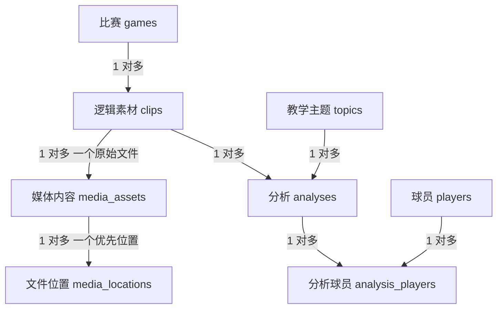

# 篮球 Film Study 素材采集与管理工具 PRD

版本：1.1  
日期：2026-10-27
本次修订：完整数据库契约，19 张表与 198 个字段；数据库结构与导出格式均明确版本。  
产品代号：Basketball Film Study OBS  
文档用途：供开发 agent 直接进行需求拆解、源码改造、跨平台构建和验收。  
交付形态：基于 OBS Studio 源码维护的 Windows 与 macOS 桌面应用。

> 实施指令：按照本文 P0 范围完成可运行版本，不止提交方案或界面原型。先锁定上游版本并完成双平台构建，再贯通录制、保存、预览、标注、查询、导出的完整流程。本文标为“实施默认”的项目允许开发 agent 在满足验收标准的前提下作等价技术调整，并记录理由，不构成等待用户确认的阻塞项。

## 1 产品结论与当前形态

产品用于个人篮球 Film Study 内容创作。用户观看比赛时保存值得分析的回合，录制停止后反复预览，给同一素材添加多条分析记录；准备内容时，通过组合条件找到素材，导出 MP4 与 JSON 信息清单。

当前产品形态已经确定：

1. 直接修改 OBS Studio 源码并维护定制分支，相关功能集成在同一个桌面软件中。
2. Windows 和 macOS 共用业务逻辑、数据模型与导出格式，分别构建与验证。
3. 使用 OBS 已有的画面采集、音频、编码与输出能力；新增篮球素材工作流。
4. MP4 存放在普通目录，SQLite 保存素材信息和关联数据。
5. 录制期间不进行标注，不弹出业务界面，不抢焦点。
6. 保存完成后，提供简单预览与多条分析编辑界面。
7. 第一版提供简单筛选与导出界面，导出完整 MP4 和一个 JSON 总清单。
8. 完整素材库、缩略图墙、专题编排、裁剪导出和云端在后续阶段扩展。

“可视化后置”指完整素材库后置。录制后预览、标注输入、筛选和错误反馈所需的基础界面属于第一版。

## 2 背景与目标

### 2.1 用户问题

用户无法稳定收集 NBA 全场 MP4，需要通过录屏保存可用于教学分析的片段。素材可能同时具有不同教学价值，单层文件夹分类容易造成重复、遗漏和分类冲突。需要根据分析视角、教学主题、正反例、球员及可选实际结果快速检索。

本产品不承担完整逐事件比赛统计任务。只记录有助于找到和解释素材的信息，不要求逐次记录传球、掩护、协防等全部事件。

### 2.2 产品目标

- 采集时尽量不打断观看比赛。
- 确保视频与标注身份稳定关联，连续录制时不串片。
- 同一素材支持多个独立分析角度。
- 组合筛选准确，避免把不同分析记录的条件拼在一起。
- 导出的素材可直接交给剪辑流程，相关分析和来源信息随文件保留。
- 为后续素材库界面、专题集合和云端迁移提供稳定数据基础。

### 2.3 成功标准

- 普通用户不需要编辑 SQLite、JSON 或执行命令，即可完成主要流程。
- 一次录制生成一个稳定素材 ID，后续编辑、重命名显示标题和导出均不改变它。
- 停止录制后，用户可以反复预览和标注；开始下一段后，上一段数据不丢失。
- 使用测试数据验证，组合检索的结果与预期完全一致。
- 每个正式导出包包含完整可读的 MP4、可解析的 manifest.json 和一致的关联信息。
- Windows 与 macOS 均提供构建记录及真实运行验证结果；未验证的平台必须明确标示，不能宣称完成。

## 3 决策来源与范围边界

### 3.1 已确认的产品决策

| 编号 | 决策 |
| --- | --- |
| D01 | 采用 OBS 源码改造，开发与发行自己的定制版本 |
| D02 | 支持 Windows 与 macOS |
| D03 | 开始录制时创建素材记录并固定 ID |
| D04 | 录制过程中不操作屏幕、不做标注 |
| D05 | 停止后等待保存完成，再关联最终文件路径并启用预览 |
| D06 | 停止后支持反复预览及多条分析的增删改 |
| D07 | 上一条标注持续保留并可修改，新素材默认清空分析，仅沿用比赛信息 |
| D08 | 筛选维度为视角、教学主题、正反例、球员、可选实际结果 |
| D09 | 使用 SQLite 管理正式数据，MP4 独立保存 |
| D10 | 当前导出 MP4 和 JSON 即可，完整可视化素材库后续实施 |
| D11 | 文件夹负责物理存放，分类与筛选由结构化数据承担 |

### 3.2 实施默认值

以下补足尚未逐项指定的交互和工程细节，不改变已确认需求。

| 项目 | 第一版默认 |
| --- | --- |
| 界面语言 | 简体中文，字段内部使用稳定 ID 和代码 |
| 首批构建目标 | Windows x64、macOS Apple Silicon arm64 |
| Intel Mac | 预留构建配置，列为 P1，不作为首版阻塞条件 |
| 上游基线 | 优先评估 OBS 33.0.0 正式 tag；实施时核验来源与工具链，锁定实际采用的 tag 和 commit |
| 数据规模 | 验证 10,000 段素材、50,000 条分析的元数据检索 |
| 录制格式 | 交付 MP4，默认 H.264 8-bit SDR 与 AAC |
| 录制画质 | 初始目标 1080p 60fps，允许通过 OBS 设置修改；不承诺提升源视频实际画质 |
| 音频 | 默认录制比赛声音，麦克风默认关闭 |
| 回放缓存 | 默认 60 秒，允许用户配置 |
| 标注保存 | 自动保存，默认停止输入 500ms 后提交；切换素材前立即提交 |
| 导出信息 | 一个 UTF-8 manifest.json，保留全部有效及草稿分析，并注明本次命中的分析 ID |
| 导出视频 | 第一版复制完整 MP4，不改画面、不转码、不裁剪 |
| 多实例 | 同一素材库同一时间只允许一个应用实例写入 |
| 云端 | 第一版无云服务依赖、无自动上传 |

如上游 tag 的依赖与本地环境不兼容，可选另一个已发布稳定 tag；必须提交技术决策记录和原因，禁止无记录地追踪 master。

## 4 交付阶段

| 阶段 | 范围 | 是否首版交付 |
| --- | --- | --- |
| P0 | 双平台构建、素材库初始化、手动录制、回放缓存保存、状态恢复、预览、多分析编辑、词表管理、组合筛选、保存筛选、完整 MP4 与 JSON 导出、元数据备份 | 是 |
| P1 | 完整素材列表或缩略图库、批量标注、沿用上一条分析的快捷操作、专题集合与顺序、选定时间段与裁剪导出、Intel Mac 构建 | 后续 |
| P2 | 云端保存与同步、多人协作、JSON 再导入与冲突处理、AI 辅助提取与建议、语义检索 | 后续 |

以下不在 P0：完整视频剪辑器、视频画面绘图、战术板、自动理解整场比赛、逐事件统计、自动内容发布、跨设备实时同步。P0 不创建重复视频来实现分类。

## 5 术语与核心数据规则

### 5.1 术语

- 素材 Clip：一次手动录制或一次回放缓存保存得到的视频及其基础记录。
- 分析记录 Analysis：对某段素材的一套教学判断，包含视角、主题、正反例、球员、实际结果和备注。
- 教学主题 Topic：用于教学检索的主题，如“快攻 1v1”“身体接触时机”“退防路线”。
- 实际结果 Result：片段中客观发生的结果，不自动决定正反例。
- 当前比赛：下一次采集使用的比赛上下文。
- 素材库 Catalog：包含数据库、视频和辅助目录的本地根目录。
- 保存筛选：用户保存的一组查询条件，未来可作为智能文件夹展示。
- 专题集合 Collection：为一期内容编排的一组素材；P1 实施，与教学主题不同。

### 5.2 分析记录必须成组关联

一个 Clip 可以关联 0 至多条 Analysis。每条 Analysis 在 P0 对应一个视角、一个主题、一种评价、0 至多名球员和一个可选结果。一个素材涉及多个主题时，增加多条 Analysis。

正反例是针对该条分析的视角与主题作出的判断。不能把“命中”自动标为正例，不能把“投失”自动标为反例。

同一视频可以同时存在：
- 进攻视角下“身体接触时机”的正例。
- 防守视角下“退防路线”的反例。
- 进攻视角下“弱手终结”的正例。

### 5.3 草稿与未标注

- Clip 可以没有分析，作为待标注素材保留。
- Analysis 支持 draft 和 complete 两种状态。
- complete 必须填写视角、教学主题、正反例。
- 球员允许暂未确认，保存为空数组；实际结果允许为空。
- draft 允许缺少核心字段，自动保存但默认不参与业务筛选。
- 缺少球员的记录不会匹配指定球员条件；结果为空的记录不会匹配指定结果条件。
- 用户需要明确点击“完成该条分析”，通过校验后从 draft 变为 complete。
- 编辑 complete 记录时，如果清空必填字段，立即回到 draft，并显示原因。

### 5.4 ID 与时间

所有业务实体使用程序生成的 UUID。文档中的 C001、A01 等为可读示例缩写。

UTC ISO 8601 固定毫秒格式保存 created_at、updated_at 等系统时间；界面按操作系统时区显示。比赛日期是独立的业务日期，不能由采集时间代替。比赛节次和剩余时间允许手工填写，数据库分别保存 period_code 和 game_clock_ms，不与录屏文件时间推算。未来的片内分析时间段使用整数毫秒。

## 6 用户界面与已达到的交互形态

### 6.1 OBS 主界面入口

在定制 OBS 中增加“Film Study”菜单和停靠面板。保留已有采集源与编码配置能力；新增业务逻辑集中在独立代码目录。

面板的基础组成：
1. 当前素材库与当前比赛。
2. 开始录制、停止录制、开始回放缓存、保存回放片段。
3. 当前或最近素材的状态与 ID。
4. 打开预览标注、筛选导出、素材库设置。

快捷键首次配置由用户在录制前完成；默认不要占用已被 OBS 或操作系统使用的组合。快捷键遵循 OBS 的平台适配与设置机制，不硬编码 Windows 按键。

### 6.2 预览与标注窗口

文件就绪后可打开：
- 视频区域：播放、暂停、进度拖动、回到开头、重复播放、音量和静音。
- 倍速：至少提供 0.5x、1.0x、1.5x；音调补偿不作为 P0 要求。
- 基础信息：素材 ID、显示标题、比赛、节次、比赛剩余时间、时长、来源链接。
- 分析区域：多条分析卡片，每条独立添加、编辑、删除或标记完成。
- 保存反馈：已保存、正在保存、保存失败。
- 切换入口：最近素材和待标注素材的简单列表，支持打开旧素材继续编辑。

简单列表只需显示标题、比赛、时间、分析数和状态；无需缩略图墙。全屏播放器、逐帧进退、画面绘图和视频裁剪不属于 P0。

### 6.3 筛选导出窗口

- 五个筛选维度都可独立指定或留空，不要求按固定顺序填写。
- 同一维度可多选。
- 支持比赛过滤、素材标题或分析备注关键字过滤。
- 显示匹配素材数、命中分析数；二者不是同一个数。
- 简单结果表显示素材 ID、比赛、标题、命中原因和文件状态。
- 支持打开素材预览、保存当前筛选、选择导出目录、执行导出。
- 不要求用户操作 SQL 或 JSON 文件。

### 6.4 录制期间界面约束

“完全不动屏幕”的产品定义：
- 用户无需鼠标点击或键盘输入标注，只通过快捷键停止或保存。
- Film Study 不弹出窗口、不自动切换应用焦点、不弹出业务通知或覆盖层。
- 不自动打开或播放素材，不更新会覆盖比赛源的业务界面。
- 已有 OBS 录制状态显示不要求删除，但业务面板不得抢到比赛前景。
- 开始新采集前，停止并释放当前预览音视频，关闭会遮挡采集目标的标注弹窗。
- 录制中锁定标注编辑、素材切换、比赛切换与词表修改。
- 首次权限申请、文件夹选择和快捷键冲突处理均在录制开始前完成。

本软件无法冻结操作系统或第三方应用产生的通知。默认引导用户采集比赛所在窗口或固定区域；验收聚焦本软件不干扰录制，并检查最终样片。采集目标本身正常播放篮球画面不受上述界面约束影响。

## 7 主流程

### 7.1 素材库初始化

FR-001：用户选择或新建一个本地素材库根目录。检查可读写、数据库版本、剩余空间及单实例锁。原始视频和数据库不放在系统临时目录。

FR-002：新库创建 SQLite、media、pending、backups 等目录；根目录与辅助目录的名称不承担篮球分类。

FR-003：当前比赛至少填写一个可辨识名称。可选比赛日期、赛季、赛事、主客队、来源名称、来源页面链接。比赛记录可复用。

FR-004：采集前检查采集源、录制输出、音频、目录和必要平台权限。检查失败时显示可修复原因，尚未开始录制时允许弹窗。

### 7.2 手动录制

FR-010：触发开始时先分配 Clip ID，并持久化 created 记录及当前比赛的关联；进入 starting 后调用 OBS 录制。

FR-011：收到 OBS 实际开始事件后进入 recording。启动失败则保留 failed 记录和原因，不假装已录制。

FR-012：录制过程中禁止标注输入与自动弹窗；触发停止快捷键进入 saving。重复按停止必须幂等，不创建额外素材。

FR-013：OBS 完成输出后，使用该次操作的输出事件和显式文件路径建立关联。禁止通过目录“最新文件”猜测归属。

FR-014：完成必要的 MP4 封装、文件验证和媒体元数据读取后，保存最终相对路径、大小、时长、编码与 SHA-256，进入 ready。

FR-015：只有 ready 且视频可读时启用预览和分析编辑。P0 在 saving 或 processing 阶段不提前开放标注表单，界面只显示非抢焦点的状态。

FR-016：保存完成后可展示后处理窗口。通过软件直接停止时允许自动打开；通过全局快捷键停止时默认以用户上次设置决定自动打开或保持在后台，首次默认自动打开。窗口出现必须在采集完全停止后。

FR-017：分析修改自动保存。关闭预览窗口不删除素材，不删除标注。

FR-018：下一次开始时创建新 Clip ID，沿用当前比赛，分析列表为空。旧素材的分析继续保存在数据库中。

FR-019：同一时刻只允许一个采集操作和一个待完成文件关联任务；saving 或 processing 时拒绝新的开始请求，以非抢焦点的方式显示说明，不建立第二条空记录。P0 不自动排队开始，以免在用户不知情时采集。

FR-020：当前比赛修改只影响后续新素材。修改已有素材的比赛归属必须在该素材的编辑界面执行。

### 7.3 回放缓存

FR-030：支持先启动回放缓存，观看比赛后保存过去 N 秒；N 默认 60 秒。开始缓存建立采集会话，保存时才创建 Clip ID。

FR-031：同一采集会话最多发出一个保存请求，收到该请求的保存完成事件后绑定文件。保存失败允许重试并保留同一操作身份，不能重复生成多个业务素材。

FR-032：P0 每次保存回放后结束本次缓存采集会话，确认缓存停止后再进入预览标注。下一次观看前由用户重新启动缓存，使用新的缓存会话。

FR-033：不允许一边播放自己的素材预览，一边继续缓存比赛声音或屏幕，避免预览声音或编辑界面混入下一段素材。

FR-034：实际缓存不足 N 秒时保留现有可用时长，并在素材信息中记录实际时长；没有有效视频时提示保存失败。

FR-035：取消尚未保存的缓存会话不生成素材。手动录制与回放缓存采集在 P0 互斥。

### 7.4 失败与恢复

FR-040：启动扫描未完成操作。能依据已持久化的操作 ID 和明确路径找到文件时，重新检查或处理；不能确认归属时进入 recovery_required，禁止随意绑定。

FR-041：文件已生成而数据库更新失败时，保留文件和旁路恢复记录，启动后可幂等恢复。恢复记录是内部日志，不是第二套可编辑标注数据。

FR-042：数据库创建失败、磁盘写满、输出失败、封装失败和预览解码失败应区别显示。封装失败保留原始录制，提供重试。

FR-043：录制进程退出后，只有验证通过的文件才变为 ready；中断的原始文件需尝试恢复，不能仅因扩展名存在而认为可用。

FR-044：文件丢失保留其标注，更新媒体可用性。提供重新定位功能；确认文件内容与原素材一致后更新路径，不能静默关联到其他视频。

## 8 标注与词表

### 8.1 字段

| 字段 | 级别 | 必填规则 | 说明 |
| --- | --- | --- | --- |
| 素材 ID | Clip | 自动 | 不可编辑 |
| 显示标题 | Clip | 可选 | 与物理文件名分离 |
| 比赛 | Clip | 采集前必选 | 新素材沿用当前比赛 |
| 节次 | Clip | 可选 | 支持加时名称 |
| 比赛剩余时间 | Clip | 可选 | 界面校验并解析为 game_clock_ms，不用于推算片内时间 |
| 来源页面与来源说明 | Clip | 可选 | 默认从比赛信息复制，素材级可覆盖 |
| 视角 | Analysis | complete 必填 | offense 或 defense |
| 教学主题 | Analysis | complete 必填 | 主题 ID，显示中文名称 |
| 评价 | Analysis | complete 必填 | positive 或 negative |
| 相关球员 | Analysis | 可选，多选 | 无法确认时为空，不虚构姓名 |
| 实际结果 | Analysis | 可选 | 结果词表 ID，空值表示未填写 |
| 分析备注 | Analysis | 可选 | 保存为什么值得讲以及判断依据 |
| 分析状态 | Analysis | 自动及手动 | draft 或 complete |

### 8.2 编辑规则

FR-050：同一素材的分析条数没有业务上限，列表按创建时间和 ID 稳定排序；验收至少覆盖单素材 100 条分析。

FR-051：增加一条分析默认是空草稿。默认不继承上一条分析，避免误标。

FR-052：允许删除分析，提供短时撤销或回收记录；删除一条不影响其他分析或视频。素材删除在 P0 只做软删除，恢复期内不物理删除 MP4。

FR-053：保存反馈对应实际数据库事务结果，失败时保留未提交编辑并禁止静默切换丢失数据。启动新录制前须刷写现有编辑；失败则在未开始录制时明确报错。

FR-054：相同素材可以存在相似或相同分析，不强制自动合并。可提示重复，但不能擅自删除。

### 8.3 词表管理

FR-060：主题、球员和实际结果均使用稳定 ID，允许新增、改名和停用。历史引用不因为改名或停用丢失。

FR-061：使用已引用的词条时不允许硬删除；停用后默认不出现在新建选择器，但仍能检索历史记录。

FR-062：球员支持别名，例如 SGA 与 Shai Gilgeous-Alexander 归到同一个 player_id；筛选可通过别名找到标准实体。

FR-063：词条显示名称按 11.4 的固定规则生成规范化键。主题与结果进行重名检查；球员姓名和跨球员别名允许相同，选择时明确身份。名称变更不修改实体 ID。

FR-064：初始主题只提供可编辑示例，不建立强制的全篮球分类体系。建议示例：快攻 1v1、身体接触时机、弱手终结、退防路线、挡拆阅读、弱侧协防。

FR-065：主题解释可填写“定义与边界”，例如说明 1v1 指局部终结人数关系；允许后续修正，软件不替用户判定篮球语义。

## 9 查询规则

### 9.1 布尔规则

设查询条件为 Q，素材为 C，分析为 A。默认命中定义：

存在属于 C 的 complete 分析 A，使 A 同时满足所有指定的分析维度，且 C 满足比赛及素材条件；C 必须未删除、采集状态 ready、媒体可用。

- 不同维度之间是 AND。
- 同一维度选择多个值时是 OR。
- 未设置的维度不加限制，不是匹配空值。
- 球员维度默认 ANY：分析的相关球员包含任意一个选中的 player_id 即符合。
- 不实现跨分析的“视角满足于 A1、主题满足于 A2、球员满足于 A3”。
- 返回素材按 clip_id 去重，同时保留全部 matched_analysis_ids。
- 关键字：素材标题匹配，或同一条已满足结构化条件的分析备注匹配；不从其他不匹配分析的备注借用命中。
- 中文关键字默认按包含子串匹配；不包含 AI 语义搜索。

### 9.2 空查询与待标注模式

FR-070：无条件查询默认返回具有至少一条 complete 分析的可用素材，命中分析为其全部 complete 分析。

FR-071：单独提供“待标注素材”模式，列出没有 complete 分析的 ready 素材。用户可打开标注，不与普通分析条件混用。

FR-072：导出待标注素材时必须显式选择该模式；matched_analysis_ids 为空，未完成分析仍可随 JSON 导出并标明 draft。

FR-073：默认结果按素材创建时间倒序、ID 作为次排序键；分页不影响“导出全部匹配”。导出默认针对本次全部匹配素材，而非当前页。

FR-074：结果界面区分“无匹配”和“符合元数据但文件不可用”。不可用素材不计入可导出数，显示数量与原因，不静默消失。

### 9.3 必须通过的反例数据

以下为虚构教学样例，不表示真实比赛事件。

| 素材 | 分析 | 视角 | 主题 | 评价 | 球员 | 结果 |
| --- | --- | --- | --- | --- | --- | --- |
| C001 | A01 | 进攻 | 身体接触时机 | 正例 | SGA | 命中 |
| C001 | A02 | 防守 | 退防路线 | 反例 | 防守球员甲 | 对手命中 |
| C001 | A03 | 进攻 | 弱手终结 | 正例 | SGA | 命中 |
| C002 | A04 | 进攻 | 身体接触时机 | 反例 | 球员乙 | 失误 |
| C003 | A05 | 防守 | 退防路线 | 正例 | 防守球员甲 | 阻止出手 |
| C004 | A06 | 进攻 | 身体接触时机 | 正例 | SGA | 空值 |

预期：
- 防守 AND 退防路线 AND 正例：只返回 C003，不能返回 C001。
- 进攻 AND 身体接触时机 AND 正例 AND SGA：返回 C001、C004。
- 上一查询加“命中”：只返回 C001。
- 身体接触时机 AND 正例 AND 球员乙：没有结果。
- 主题多选 身体接触时机、弱手终结，评价正例，球员 SGA：返回 C001、C004；C001 只复制一次，matched_analysis_ids 为 A01、A03。
- 指定结果“失误”：C004 的空结果不匹配。

### 9.4 保存筛选

FR-080：用户可命名并保存当前条件，下次载入时重新查询当前数据库，不保存静态视频副本。

FR-081：词条改名不破坏筛选，筛选按词条 ID 保存。词条停用时继续支持历史查询；缺失或无法解释的条件应显示错误，不自动扩大查询范围。

## 10 MP4 与 JSON 导出

### 10.1 导出流程

FR-090：用户选择导出目录，软件基于当前过滤条件创建一次不可变的元数据快照，再复制文件。复制期间修改标注不改变本次清单，下一次导出反映新值。

FR-091：开始前检查源视频、目标目录、空间和可用性。默认导出全部匹配；任何必需素材不可用时阻止开始并展示问题。用户可显式排除后重新生成快照。

FR-092：导出包路径示例为 FilmStudy_20261027_203000_短ID，包内为 media/<clip_uuid>.mp4 和 manifest.json。标题、主题或球员不作为唯一文件名。

FR-093：同一素材只复制一次；复制为原始文件字节，不修改、不重新编码。导出时计算或验证 SHA-256，与素材登记的内容哈希一致；原文件被外部修改时标记异常，要求用户处理。

FR-094：先写同一目标文件系统内的临时导出目录。文件复制、哈希核验与 JSON 校验均成功后，再发布为最终目录。任何失败都不得显示“导出完成”。

FR-095：导出支持进度与取消。取消只清理本次临时副本，不删除原始素材。已有同名目标使用新包 ID，默认不覆盖。

FR-096：导出完成展示素材数、分析数、包路径和打开文件夹入口。0 个匹配时不创建空成功包。

FR-097：所有媒体路径使用包内相对路径和正斜杠；不得在 JSON 中保存本机绝对视频路径作为播放依赖。搬移整个导出包后仍可根据清单找到视频。

### 10.2 JSON 必需字段

| 层级 | 字段 | 规则 |
| --- | --- | --- |
| 包 | schema_version | 整数，本次数据库契约修订后的导出格式为 2 |
| 包 | export_id | UUID |
| 包 | exported_at | UTC ISO 8601 |
| 包 | application | 产品版本、上游 tag 与 commit |
| 包 | query | 本次标准化查询，包含逻辑版本 |
| 包 | clip_count、analysis_count | 与实际内容一致 |
| 包 | catalog_id、snapshot_catalog_revision | 来源素材库身份及冻结时的全库内容版本 |
| 包 | clips | 素材数组 |
| 素材 | clip_id、revision | 稳定身份及导出快照版本 |
| 素材 | title、capture_mode、created_at | 基本信息 |
| 素材 | file | asset_id、包内相对路径、大小、SHA-256、时长、视频与音频编码 |
| 素材 | game | 比赛 ID、名称及可选日期、赛季、球队 |
| 素材 | source、period、game_clock、game_clock_ms | 来源及可选比赛定位信息；格式化时钟从整数毫秒生成 |
| 素材 | matched_analysis_ids | 本次真正命中的分析 ID 数组 |
| 素材 | analyses | 该素材所有未删除分析，包含草稿并明确状态 |
| 分析 | analysis_id、revision、status | 稳定身份与状态 |
| 分析 | reference_asset_id、range | 原始时间轴 ID；整段为 range=null，片段为 start_ms、end_ms |
| 分析 | perspective、topic、assessment | 核心字段，草稿可为空 |
| 分析 | players | ID、标准名称、别名与 role 的数组，可为空 |
| 分析 | actual_result | ID 与名称，或 null |
| 分析 | note、created_at、updated_at | 分析内容及时间 |

规则：
- 中文使用 UTF-8，JSON 中 null 与空数组含义不同，禁止用“未知”伪造一个实际球员。
- topic、player、result 均导出 ID 与当前显示名称，保证机器关联与人工可读。
- 实际结果不由评价推算，不根据得分自动生成正反例。
- matched_analysis_ids 必须是本条 analyses 的子集，正常分析查询只能指向 complete。
- metadata schema_version 与数据库 user_version 独立，本次均为 2；查询逻辑 query_version 仍为 1，未来不要求同步递增。
- 格式 2 明确媒体 asset_id、分析 reference_asset_id、range 和球员 role。旧格式 1 的解析与升级属于后续导入能力，不能把旧清单静默标成 2。
- P0 不把导出 JSON 作为日常自动写回的数据源，不提供隐式双向同步。
- P0 不要求剪辑软件读取标签；JSON 是供后续程序、迁移或人工分析使用的信息清单。
- 所有未命中但属于素材的分析保留在 analyses；导出命中原因以 matched_analysis_ids 为准。
- 后续范围裁剪导出须新增源素材与派生文件映射，不能复用 clip_id 假装仍是原始字节。

### 10.3 JSON 示例

下列为结构示例，大小、哈希和时长为占位示例，生产数据必须从真实文件生成。

```json
{
  "schema_version": 2,
  "export_id": "example-export-id",
  "exported_at": "2026-10-27T12:30:00Z",
  "application": {
    "name": "Basketball Film Study OBS",
    "version": "0.1.0",
    "upstream_tag": "locked-at-build",
    "upstream_commit": "locked-at-build"
  },
  "query": {
    "logic_version": 1,
    "mode": "analysed",
    "perspectives": [
      "offense"
    ],
    "topic_ids": [
      "T01"
    ],
    "assessments": [
      "positive"
    ],
    "player_ids": [
      "P01"
    ],
    "player_match": "any",
    "result_ids": [],
    "game_ids": [],
    "keyword": ""
  },
  "clip_count": 1,
  "analysis_count": 2,
  "clips": [
    {
      "clip_id": "C001",
      "revision": 3,
      "title": "主动接触后完成终结",
      "capture_mode": "manual",
      "created_at": "2026-10-27T12:00:00Z",
      "file": {
        "path": "media/C001.mp4",
        "size_bytes": 10000000,
        "sha256": "0000000000000000000000000000000000000000000000000000000000000000",
        "duration_ms": 28000,
        "video_codec": "h264",
        "audio_codec": "aac",
        "asset_id": "M001"
      },
      "game": {
        "game_id": "G001",
        "name": "示例比赛",
        "game_date": null,
        "season": null,
        "home_team": null,
        "away_team": null
      },
      "source": {
        "name": "用户填写的来源",
        "url": null,
        "note": ""
      },
      "period": "Q3",
      "game_clock": "08:42",
      "matched_analysis_ids": [
        "A01"
      ],
      "analyses": [
        {
          "analysis_id": "A01",
          "revision": 1,
          "status": "complete",
          "perspective": "offense",
          "topic": {
            "topic_id": "T01",
            "name": "身体接触时机"
          },
          "assessment": "positive",
          "players": [
            {
              "player_id": "P01",
              "name": "SGA",
              "aliases": [
                "Shai Gilgeous-Alexander"
              ],
              "role": "focus"
            }
          ],
          "actual_result": {
            "result_id": "R01",
            "name": "命中"
          },
          "note": "分析主动接触的时机与空间变化",
          "created_at": "2026-10-27T12:01:00Z",
          "updated_at": "2026-10-27T12:02:00Z",
          "reference_asset_id": "M001",
          "range": null
        },
        {
          "analysis_id": "A02",
          "revision": 1,
          "status": "complete",
          "perspective": "defense",
          "topic": {
            "topic_id": "T02",
            "name": "退防路线"
          },
          "assessment": "negative",
          "players": [],
          "actual_result": null,
          "note": "防守侧的独立分析",
          "created_at": "2026-10-27T12:03:00Z",
          "updated_at": "2026-10-27T12:03:00Z",
          "reference_asset_id": "M001",
          "range": null
        }
      ],
      "game_clock_ms": 522000
    }
  ],
  "catalog_id": "example-catalog-id",
  "snapshot_catalog_revision": 12
}
```

## 11 数据库结构与字段规划

本章与附录 A、B 是开发的数据契约。数据库结构版本为 2，PRD 文档版本为 1.1；它们与导出 JSON 版本和查询语义版本分别管理。旧版附录中的平铺结构由本章替代，不应同时维护两套模型。

### 11.1 设计原则与身份边界

数据库负责结构化业务信息与可靠的操作记录，视频仍保存为普通文件。第一版建立可扩展的当前数据模型，不提前实现多人权限、云同步或完整事件统计。

必须区分四种身份：
1. clip_id：逻辑素材；分析、保存筛选结果和未来专题引用它。
2. asset_id：具体不可变视频内容；同一素材未来可以有原始、代理和裁剪版本。
3. location_id：当前文件的本地位置；移动或重新定位不改变素材和内容身份。
4. analysis_id：一组完整教学判断；视角、主题、正反例、球员和结果必须在此范围内共同成立。

禁止将 MP4 路径作为 Clip 主键，禁止把教学主题编码进目录结构，禁止因两段素材哈希相同就自动合并它们。两个独立采集的回合可有相同字节而仍保持不同素材身份。

P0 只产生一个 original Asset，尚不产生代理或裁剪文件；但这些类型的约束及片内范围字段先建立，后续增加操作界面不需要重写已有分析的归属。

### 11.2 核心关系



补充关系：
- clips.primary_asset_id 只能引用属于该素材的 original 文件，确认后不再更换身份。
- analyses.reference_asset_id 引用该素材的原始时间轴；未来预览代理不能悄悄更改时间坐标。
- result_types 是可选的分析结果词表，与正反例独立。
- capture_sessions 可以先于 Clip 存在，解决“已启动回放缓存但尚未保存素材”的持久化。
- 一个 Clip 对应一个逻辑 capture_operation；重试增加 attempt_count，详细事实追加到 operation_events。
- export_jobs 保存冻结清单，export_items 保存唯一视频项，export_item_matches 保存本次命中的分析及版本。

### 11.3 表清单与建设阶段

| 表 | 业务职责 | P0 建立 | 后续依赖 |
| --- | --- | --- | --- |
| catalog_info | 素材库身份、内容版本和名称规范化版本 | 是 | 库迁移、云端归属 |
| schema_migrations | 已成功执行的数据库迁移 | 是 | 长期升级 |
| games | 比赛与默认来源上下文 | 是 | 赛程关联 |
| players | 球员身份，允许同名 | 是 | 外部身份映射 |
| player_aliases | 标准姓名之外的检索别名 | 是 | 多语言名称 |
| topics | 教学主题与概念边界 | 是 | 主题层级 |
| result_types | 实际结果口径 | 是 | 更细结果分类 |
| clips | 逻辑素材及其采集状态 | 是 | 素材库、专题集合 |
| media_assets | 不可变视频内容、编码与哈希 | 是 | 代理、裁剪 |
| media_locations | 本地位置与可用性 | 是 | 重新定位、云端位置扩展 |
| analyses | 成组的分析字段与原始时间轴 | 是 | 片内范围编辑 |
| analysis_players | 球员和其分析角色 | 是 | 主体与背景的区分 |
| capture_sessions | 连续采集会话 | 是 | 缓存恢复 |
| capture_operations | 一次素材采集操作及重试 | 是 | 可靠恢复 |
| operation_events | 追加式状态事实与去重 | 是 | 诊断与幂等 |
| saved_filters | 可重复执行的查询定义 | 是 | 智能文件夹 |
| export_jobs | 导出任务和不可变信息快照 | 是 | 历史导出、未来重试 |
| export_items | 去重后实际复制的文件 | 是 | 复制进度与核验 |
| export_item_matches | 命中分析和快照版本 | 是 | 导出原因追踪 |

共 19 张 P0 表。它们不增加云端、批量标注或完整素材库的首版交互范围。后续业务表的方向在 11.16 中说明，不要求第一版空建所有远期表。

### 11.4 通用字段与编码规范

| 项目 | 规范 |
| --- | --- |
| UUID | 业务 ID 使用小写标准 UUID 字符串，由应用生成；不依赖数据库自增顺序，不从名称或路径生成 |
| 迁移产生的 ID | 允许使用已记录命名空间的 UUIDv5，保证重试幂等；正常新建使用 UUIDv4 |
| created_at、updated_at | TEXT，固定 UTC ISO 8601 格式 YYYY-MM-DDTHH:mm:ss.SSSZ，服务层严格验证；界面转换时区 |
| revision | INTEGER，从 1 开始；每次成功的业务修改递增，失败回滚不递增 |
| deleted_at | 可空时间戳；有值表示软删除，不自动删除文件与关联 |
| INTEGER 布尔值 | 仅允许 0 或 1，不能将 true 字符串写入 |
| 可选值 | 未知或未填写用 NULL；空关联用零行关系记录；不虚构“未知球员”实体 |
| 文本 | 业务原始文本保持可读；需要比较的 name_key、alias_key 单独计算 |
| 名称规范化 | normalization_version=1：Unicode NFKC、完整 case folding、首尾空白移除、连续 Unicode 空白折叠；保留具有语义的标点 |
| 规范化兼容 | 两平台使用一致库与版本；升级规范化算法先检查冲突，不直接批量覆盖 |
| 路径 | 相对库根目录，正斜杠，无盘符、无绝对前缀；生成文件名只使用 UUID 与固定后缀 |
| 时间长度 | 视频时长、片内范围和比赛时钟均使用整数毫秒，但属于不同坐标系 |
| 哈希 | 64 位小写 SHA-256；哈希描述字节内容，不能代替业务身份 |
| 帧率 | 分子与分母两列，如 60000/1001；不只保存四舍五入后的 59.94 |
| 枚举 | 采用文档中固定英文代码；新增值需兼容性评估与迁移，不随界面文案改变 |
| JSON | 仅用于版本化操作快照、查询和导出快照；核心分析、主题、球员关系必须正规化建表 |

数据库基础依赖使用 SQLite 3.38 或更新版本，并在启动时确认 STRICT 和 JSON 函数可用。版本满足但编译时省略相关能力也视为不满足。表使用 STRICT；每个连接启用 foreign_keys，配置 busy_timeout，主库启用 WAL。默认使用 synchronous=FULL；性能调整必须以崩溃恢复与数据持久性验证为依据。

以下字段字典由对应 DDL 核对生成，覆盖每张表的全部字段。必填表示 SQL NOT NULL；部分“可空”字段在特定业务状态仍必须填写，状态条件见含义和约束说明。所有 SQL CHECK、唯一索引及触发器以附录 A 为准。

### 11.5 完整字段字典

#### 11.5.1 catalog_info

素材库身份和全库内容版本。单库只有一行，不保存机器绝对路径。

| 字段 | SQLite 类型 | 必填与默认 | 键与关联 | 含义与写入规则 |
| --- | --- | --- | --- | --- |
| singleton | INTEGER | 必填 | 主键 | 固定为 1，保证单行；不是对外业务 ID。 |
| catalog_id | TEXT | 必填 | 唯一 | 素材库的永久 UUID；复制或跨平台搬移整个库时保持不变，新建空库才创建新值。 |
| normalization_version | INTEGER | 必填；默认 1 | — | 名称和别名规范化算法版本；变更前须做冲突检测与迁移。 |
| min_reader_schema | INTEGER | 必填；默认 2 | — | 允许打开该库的最低数据库结构版本；旧应用不得写入自己不理解的库。 |
| content_revision | INTEGER | 必填；默认 0 | — | 全库业务内容提交序号；每次标注、词表、比赛或软删除事务递增一次，导出记录此值。 |
| created_at | TEXT | 必填 | — | 首次创建或登记时间，UTC 固定格式；旧值未知的迁移记录应在报告中说明采用迁移时间。 |
| updated_at | TEXT | 必填 | — | 本行最近一次成功提交时间，UTC 固定格式；不是文件修改时间。 |

#### 11.5.2 schema_migrations

已成功执行的结构迁移清单，与 PRAGMA user_version 交叉校验。

| 字段 | SQLite 类型 | 必填与默认 | 键与关联 | 含义与写入规则 |
| --- | --- | --- | --- | --- |
| version | INTEGER | 必填 | 主键 | 结构版本，顺序递增，不使用文档版本号。 |
| migration_name | TEXT | 必填 | — | 稳定迁移脚本名称，便于定位部署记录。 |
| script_sha256 | TEXT | 必填 | — | 实际迁移脚本的 SHA-256；同版本校验和变化时停止自动升级，禁止篡改已执行迁移。 |
| applied_at | TEXT | 必填 | — | 该版本事务成功执行的 UTC 时间。 |
| application_version | TEXT | 必填 | — | 执行迁移的应用版本；不代替结构版本。 |

#### 11.5.3 games

比赛身份与下一次采集可继承的默认上下文。名称与比赛日期均不作为唯一键。

| 字段 | SQLite 类型 | 必填与默认 | 键与关联 | 含义与写入规则 |
| --- | --- | --- | --- | --- |
| id | TEXT | 必填 | 主键 | 实体永久 UUID；应用生成，正常业务不变更，不从名称、数组序号或路径生成。 |
| name | TEXT | 必填 | — | 用户可辨识的比赛名称，可与另一场比赛同名。 |
| game_date | TEXT | 可空 | — | 比赛当地业务日期 YYYY-MM-DD，可为空；不从采集时间推算。 |
| season | TEXT | 可空 | — | 自由文本赛季，例如 2026-27；可为空。 |
| competition | TEXT | 可空 | — | 赛事名称，可为空。 |
| home_team_name | TEXT | 可空 | — | 主队名称文本；P1 如引入球队实体再建立 ID 关联。 |
| away_team_name | TEXT | 可空 | — | 客队名称文本，不从球员当前球队反推。 |
| default_source_name | TEXT | 可空 | — | 后续新素材默认来源名称；修改不会追溯覆盖 clips。 |
| default_source_url | TEXT | 可空 | — | 后续新素材默认来源页面 URL，可空。 |
| default_source_note | TEXT | 必填；默认 '' | — | 后续新素材默认来源说明；写入 Clip 时形成独立副本。 |
| is_archived | INTEGER | 必填；默认 0 | — | 归档后不作为新采集默认项，历史素材仍可检索。 |
| revision | INTEGER | 必填；默认 1 | — | 实体内容版本，从 1 开始；由所属服务在事务中递增并进行乐观冲突检查。 |
| created_at | TEXT | 必填 | — | 首次创建或登记时间，UTC 固定格式；旧值未知的迁移记录应在报告中说明采用迁移时间。 |
| updated_at | TEXT | 必填 | — | 本行最近一次成功提交时间，UTC 固定格式；不是文件修改时间。 |

#### 11.5.4 players

球员身份词表。姓名不唯一，允许同名球员。

| 字段 | SQLite 类型 | 必填与默认 | 键与关联 | 含义与写入规则 |
| --- | --- | --- | --- | --- |
| id | TEXT | 必填 | 主键 | 实体永久 UUID；应用生成，正常业务不变更，不从名称、数组序号或路径生成。 |
| name | TEXT | 必填 | — | 标准显示名，允许重名；依靠 ID、外部身份和身份说明区分。 |
| name_key | TEXT | 必填 | — | 标准显示名的规范化搜索键，只建普通索引，不设唯一约束。 |
| identity_note | TEXT | 必填；默认 '' | — | 同名身份说明，如联赛、出生年份或其他辨识信息；不代表固定球队归属。 |
| external_provider | TEXT | 可空 | — | 可选权威来源命名空间，如 nba；P0 不自动联网。 |
| external_id | TEXT | 可空 | — | 对应来源的稳定球员 ID；与 provider 同时为空或同时有值，组合唯一。 |
| is_active | INTEGER | 必填；默认 1 | — | 停用后保留历史分析引用。 |
| revision | INTEGER | 必填；默认 1 | — | 实体内容版本，从 1 开始；由所属服务在事务中递增并进行乐观冲突检查。 |
| created_at | TEXT | 必填 | — | 首次创建或登记时间，UTC 固定格式；旧值未知的迁移记录应在报告中说明采用迁移时间。 |
| updated_at | TEXT | 必填 | — | 本行最近一次成功提交时间，UTC 固定格式；不是文件修改时间。 |

#### 11.5.5 player_aliases

同一球员的别名。别名可以指向多个候选球员，查询时由用户选择实体。

| 字段 | SQLite 类型 | 必填与默认 | 键与关联 | 含义与写入规则 |
| --- | --- | --- | --- | --- |
| id | TEXT | 必填 | 主键 | 实体永久 UUID；应用生成，正常业务不变更，不从名称、数组序号或路径生成。 |
| player_id | TEXT | 必填 | FK → players.id | 别名所属球员；删除球员被引用时受外键限制。 |
| alias | TEXT | 必填 | — | 原始显示别名，如 SGA、中文译名。 |
| alias_key | TEXT | 必填 | — | 规范化检索键；仅在同一球员内唯一，不全局唯一。 |
| created_at | TEXT | 必填 | — | 首次创建或登记时间，UTC 固定格式；旧值未知的迁移记录应在报告中说明采用迁移时间。 |

#### 11.5.6 topics

教学主题词表。一条 Analysis 对应一个主题，多个主题使用多条 Analysis。

| 字段 | SQLite 类型 | 必填与默认 | 键与关联 | 含义与写入规则 |
| --- | --- | --- | --- | --- |
| id | TEXT | 必填 | 主键 | 实体永久 UUID；应用生成，正常业务不变更，不从名称、数组序号或路径生成。 |
| name | TEXT | 必填 | — | 主题显示名，当前平面词表中规范化后唯一；概念不同应使用明确限定名称。 |
| name_key | TEXT | 必填 | 唯一 | 用于重名检查，唯一。主题改名不改变 ID。 |
| definition | TEXT | 必填；默认 '' | — | 主题定义、1v1 等概念的边界与标注说明。 |
| is_active | INTEGER | 必填；默认 1 | — | 停用不删除历史关联与保存筛选。 |
| revision | INTEGER | 必填；默认 1 | — | 实体内容版本，从 1 开始；由所属服务在事务中递增并进行乐观冲突检查。 |
| created_at | TEXT | 必填 | — | 首次创建或登记时间，UTC 固定格式；旧值未知的迁移记录应在报告中说明采用迁移时间。 |
| updated_at | TEXT | 必填 | — | 本行最近一次成功提交时间，UTC 固定格式；不是文件修改时间。 |

#### 11.5.7 result_types

实际结果词表，独立于正反例，不假设正例必然得分。

| 字段 | SQLite 类型 | 必填与默认 | 键与关联 | 含义与写入规则 |
| --- | --- | --- | --- | --- |
| id | TEXT | 必填 | 主键 | 实体永久 UUID；应用生成，正常业务不变更，不从名称、数组序号或路径生成。 |
| name | TEXT | 必填 | — | 结果显示名，如命中、投失、失误、造犯规。 |
| name_key | TEXT | 必填 | 唯一 | 规范化后的唯一词条名称。 |
| definition | TEXT | 必填；默认 '' | — | 结果的标注口径；同一客观事实允许在分析视角中说明其主体。 |
| is_active | INTEGER | 必填；默认 1 | — | 停用词条仍可用于历史查询。 |
| revision | INTEGER | 必填；默认 1 | — | 实体内容版本，从 1 开始；由所属服务在事务中递增并进行乐观冲突检查。 |
| created_at | TEXT | 必填 | — | 首次创建或登记时间，UTC 固定格式；旧值未知的迁移记录应在报告中说明采用迁移时间。 |
| updated_at | TEXT | 必填 | — | 本行最近一次成功提交时间，UTC 固定格式；不是文件修改时间。 |

#### 11.5.8 clips

逻辑素材，是标注与专题的稳定归属。具体 MP4 属性转移到 media_assets，位置转移到 media_locations。

| 字段 | SQLite 类型 | 必填与默认 | 键与关联 | 含义与写入规则 |
| --- | --- | --- | --- | --- |
| id | TEXT | 必填 | 主键；FK → media_assets.clip_id | 实体永久 UUID；应用生成，正常业务不变更，不从名称、数组序号或路径生成。 |
| game_id | TEXT | 必填 | FK → games.id | 比赛 ID。修改当前比赛不更改已有素材的这个字段。 |
| title | TEXT | 必填；默认 '' | — | 人工显示标题，不承担文件身份，不直接拼接成物理路径。 |
| capture_mode | TEXT | 必填 | — | manual 手动录制或 replay 回放缓存保存。 |
| capture_state | TEXT | 必填 | — | created/starting/recording/saving/processing/ready/failed/recovery_required/cancelled；由采集服务统一更新。 |
| primary_asset_id | TEXT | 可空 | FK → media_assets.id | 最终原始 MP4 的 asset_id；首次确认后保持不变，必须属于同一 Clip。 |
| source_name | TEXT | 可空 | — | 采集创建时继承当前比赛默认来源，可独立修改。 |
| source_url | TEXT | 可空 | — | 该段素材的来源页面地址，允许为空。 |
| source_note | TEXT | 必填；默认 '' | — | 该段素材的来源说明，不随比赛默认项自动更新。 |
| period_code | TEXT | 可空 | — | 比赛节次代码，如 Q3、OT1；允许空，服务层校验。 |
| game_clock_ms | INTEGER | 可空 | — | 比赛剩余时间的整数毫秒；08:42 保存为 522000，界面和导出可格式化；不是片内时间。 |
| revision | INTEGER | 必填；默认 1 | — | 实体内容版本，从 1 开始；由所属服务在事务中递增并进行乐观冲突检查。 |
| created_at | TEXT | 必填 | — | 首次创建或登记时间，UTC 固定格式；旧值未知的迁移记录应在报告中说明采用迁移时间。 |
| updated_at | TEXT | 必填 | — | 本行最近一次成功提交时间，UTC 固定格式；不是文件修改时间。 |
| deleted_at | TEXT | 可空 | — | 软删除 UTC 时间；NULL 表示未删除，删除不改变 ID 或自动删除视频。 |

#### 11.5.9 media_assets

不可变的媒体内容对象。一个素材 P0 只有一个 original；后续 proxy、excerpt 使用新 ID。

| 字段 | SQLite 类型 | 必填与默认 | 键与关联 | 含义与写入规则 |
| --- | --- | --- | --- | --- |
| id | TEXT | 必填 | 主键 | 实体永久 UUID；应用生成，正常业务不变更，不从名称、数组序号或路径生成。 |
| clip_id | TEXT | 必填 | FK → media_assets.clip_id；FK → clips.id | 逻辑归属，固定。与 id 组成被复合外键引用的候选键。 |
| asset_kind | TEXT | 必填 | — | original 原始成品、proxy 代理预览、excerpt 裁剪派生。P0 只生成 original。 |
| parent_asset_id | TEXT | 可空 | FK → media_assets.id | 派生内容的父文件 ID，必须属于同一 Clip；original 必须为空。 |
| parent_start_ms | INTEGER | 可空 | — | excerpt 在父文件中的起点，含该时间点；其他类型为空。 |
| parent_end_ms | INTEGER | 可空 | — | excerpt 在父文件中的终点，不含该时间点；大于起点。 |
| container | TEXT | 必填 | — | 实际容器，P0 original 必须为 mp4，不能只根据扩展名判断。 |
| video_codec | TEXT | 必填 | — | 探测出的实际视频编码，如 h264。 |
| audio_codec | TEXT | 可空 | — | 实际音频编码；无音轨为 NULL，不使用字符串 unknown。 |
| width | INTEGER | 必填 | — | 编码视频宽度，像素，正整数。 |
| height | INTEGER | 必填 | — | 编码视频高度，像素，正整数。 |
| fps_num | INTEGER | 必填 | — | 帧率有理数分子，例如 60000。 |
| fps_den | INTEGER | 必填 | — | 帧率有理数分母，例如 1001；禁止只存近似浮点数。 |
| duration_ms | INTEGER | 必填 | — | 已验证媒体的片内时间轴长度，整数毫秒。 |
| size_bytes | INTEGER | 必填 | — | 最终文件字节数，必须大于 0。 |
| sha256 | TEXT | 必填 | — | 最终文件字节的 64 位小写十六进制哈希；建立非唯一索引，同内容可对应不同录制素材。 |
| verification_state | TEXT | 必填；默认 'verified' | — | verified 已验证或 quarantined 内容异常隔离；改变此状态不能修改内容身份或哈希。 |
| created_at | TEXT | 必填 | — | 首次创建或登记时间，UTC 固定格式；旧值未知的迁移记录应在报告中说明采用迁移时间。 |

#### 11.5.10 media_locations

某个文件内容在当前素材库中的本地位置和可用性。移动文件不修改 asset_id。

| 字段 | SQLite 类型 | 必填与默认 | 键与关联 | 含义与写入规则 |
| --- | --- | --- | --- | --- |
| id | TEXT | 必填 | 主键 | 实体永久 UUID；应用生成，正常业务不变更，不从名称、数组序号或路径生成。 |
| asset_id | TEXT | 必填 | FK → media_assets.id | 对应不可变文件对象。一个 Asset 可保留多个位置记录。 |
| relative_path | TEXT | 必填 | — | 相对库根目录的路径，正斜杠；服务层还须验证无路径穿越与目录逃逸。 |
| path_key | TEXT | 必填 | 唯一 | 规范化后的路径唯一键；本产品生成 ASCII UUID 文件名，避免大小写和 Unicode 文件名跨平台冲突。 |
| availability | TEXT | 必填；默认 'unverified' | — | unverified/available/missing/invalid；文件丢失只改位置状态，不删除素材和分析。 |
| is_preferred | INTEGER | 必填；默认 0 | — | 当前优先位置；每个 Asset 至多一个，重新定位时在同一事务中切换。 |
| last_verified_at | TEXT | 可空 | — | 最后一次内容一致性检查的时间，不等于本次程序启动时间。 |
| observed_size_bytes | INTEGER | 可空 | — | 最后观察到的大小，仅用于快速异常检查，不能代替内容哈希。 |
| observed_mtime_ns | INTEGER | 可空 | — | 最后观察到的文件修改时间，整数纳秒，仅作为线索；迁移时允许重新观察。 |
| created_at | TEXT | 必填 | — | 首次创建或登记时间，UTC 固定格式；旧值未知的迁移记录应在报告中说明采用迁移时间。 |
| updated_at | TEXT | 必填 | — | 本行最近一次成功提交时间，UTC 固定格式；不是文件修改时间。 |

#### 11.5.11 analyses

可被准确查询的一组分析字段。时间轴默认引用 Clip 的 original。

| 字段 | SQLite 类型 | 必填与默认 | 键与关联 | 含义与写入规则 |
| --- | --- | --- | --- | --- |
| id | TEXT | 必填 | 主键 | 实体永久 UUID；应用生成，正常业务不变更，不从名称、数组序号或路径生成。 |
| clip_id | TEXT | 必填 | FK → media_assets.clip_id；FK → clips.id | 所属逻辑素材；不同 Clip 的 Analysis 不得混用媒体引用。 |
| reference_asset_id | TEXT | 可空 | FK → media_assets.id | 分析使用的原始媒体时间轴 ID。正常新建必填；仅旧数据缺少媒体时可暂空，且所属 Clip 必须处于 recovery_required。 |
| status | TEXT | 必填；默认 'draft' | — | draft 或 complete；complete 要求视角、主题、正反例已填。球员和结果仍可空。 |
| perspective | TEXT | 可空 | — | offense 或 defense；草稿允许 NULL。 |
| topic_id | TEXT | 可空 | FK → topics.id | 本条教学主题 ID，草稿可空，不把多个主题塞进一个字符串。 |
| assessment | TEXT | 可空 | — | positive 或 negative；对本条主题和视角的判断，草稿可空。 |
| result_id | TEXT | 可空 | FK → result_types.id | 实际结果词条 ID，可空；不由 assessment 自动生成。 |
| range_start_ms | INTEGER | 可空 | — | 分析片内起点，含；与终点同时为空表示整段原始文件。P0 界面统一写 NULL。 |
| range_end_ms | INTEGER | 可空 | — | 分析片内终点，不含；有值时满足 0 <= start < end <= reference_asset.duration_ms。 |
| note | TEXT | 必填；默认 '' | — | 分析依据与讲解意图。正反例可能不同，备注也属于该条 Analysis。 |
| revision | INTEGER | 必填；默认 1 | — | 实体内容版本，从 1 开始；由所属服务在事务中递增并进行乐观冲突检查。 |
| created_at | TEXT | 必填 | — | 首次创建或登记时间，UTC 固定格式；旧值未知的迁移记录应在报告中说明采用迁移时间。 |
| updated_at | TEXT | 必填 | — | 本行最近一次成功提交时间，UTC 固定格式；不是文件修改时间。 |
| deleted_at | TEXT | 可空 | — | 软删除 UTC 时间；NULL 表示未删除，删除不改变 ID 或自动删除视频。 |

#### 11.5.12 analysis_players

分析与球员的多对多关系，避免把片中所有人都作为分析主体。

| 字段 | SQLite 类型 | 必填与默认 | 键与关联 | 含义与写入规则 |
| --- | --- | --- | --- | --- |
| analysis_id | TEXT | 必填 | 联合主键；FK → analyses.id | 本条分析 ID，和 player_id 组成主键，防止重复关联。 |
| player_id | TEXT | 必填 | 联合主键；FK → players.id | 关联球员实体 ID。 |
| role | TEXT | 必填；默认 'focus' | — | focus 分析主体、context 背景参与者。P0 所有用户选中的球员写 focus；默认筛选只匹配 focus。 |
| created_at | TEXT | 必填 | — | 首次创建或登记时间，UTC 固定格式；旧值未知的迁移记录应在报告中说明采用迁移时间。 |

#### 11.5.13 capture_sessions

一次连续采集上下文，尤其支持开始缓存时还不存在 Clip。

| 字段 | SQLite 类型 | 必填与默认 | 键与关联 | 含义与写入规则 |
| --- | --- | --- | --- | --- |
| id | TEXT | 必填 | 主键 | 实体永久 UUID；应用生成，正常业务不变更，不从名称、数组序号或路径生成。 |
| game_id | TEXT | 必填 | FK → games.id | 会话启动时固定的比赛 ID。 |
| mode | TEXT | 必填 | — | manual 或 replay，启动后不可静默切换。 |
| state | TEXT | 必填 | — | starting/active/stopping/stopped/failed/cancelled/recovery_required；同库最多一个活跃会话。 |
| source_snapshot_json | TEXT | 必填 | — | 版本化技术快照，记录采集源类型、场景和录制配置标识等；不是标注数据，也不保证跨重启继续采集。 |
| snapshot_version | INTEGER | 必填；默认 1 | — | source_snapshot_json 的协议版本，初始为 1。 |
| requested_buffer_ms | INTEGER | 可空 | — | 缓存目标时长；manual 必须 NULL，replay 由配置填入。 |
| started_at | TEXT | 可空 | — | OBS 真正开始采集时间；请求失败时可空。 |
| stopped_at | TEXT | 可空 | — | OBS 真正停止时间，不能用点击按钮的时间冒充。 |
| created_at | TEXT | 必填 | — | 首次创建或登记时间，UTC 固定格式；旧值未知的迁移记录应在报告中说明采用迁移时间。 |
| updated_at | TEXT | 必填 | — | 本行最近一次成功提交时间，UTC 固定格式；不是文件修改时间。 |

#### 11.5.14 capture_operations

将一次素材采集和最终文件发布绑定。每个 Clip 一个逻辑 Operation，重试不换 ID。

| 字段 | SQLite 类型 | 必填与默认 | 键与关联 | 含义与写入规则 |
| --- | --- | --- | --- | --- |
| id | TEXT | 必填 | 主键 | 实体永久 UUID；应用生成，正常业务不变更，不从名称、数组序号或路径生成。 |
| session_id | TEXT | 必填 | FK → capture_sessions.id | 所属连续会话，与操作 ID 组成事件表的复合外键。 |
| clip_id | TEXT | 必填 | FK → media_assets.clip_id；FK → clips.id | 唯一的目标素材；同 Clip 不重复建立另一个主采集操作。 |
| phase | TEXT | 必填 | — | 与 Clip.capture_state 对应的操作阶段；服务在同一事务同步两者。 |
| attempt_count | INTEGER | 必填；默认 1 | — | 尝试序号从 1 开始；每次真实重试递增，旧尝试信息保留在事件中。 |
| raw_relpath | TEXT | 可空 | — | 当前尝试的原始 MKV 等临时文件位置，可在开始前按唯一标识确定。 |
| intended_final_relpath | TEXT | 必填 | — | 采集前固定的预期最终 MP4 相对路径，帮助崩溃恢复。 |
| actual_output_relpath | TEXT | 可空 | — | 从 OBS 实际事件取得的输出路径，规范化为库内相对路径，不取最新文件猜测。 |
| final_asset_id | TEXT | 可空 | FK → media_assets.id | 验证完成后发布的 original Asset，必须属于同一 Clip。 |
| error_code | TEXT | 可空 | — | 稳定机器错误码，NULL 表示当前无错误。 |
| error_message | TEXT | 可空 | — | 人可读诊断说明，不能代替错误码或状态。 |
| created_at | TEXT | 必填 | — | 首次创建或登记时间，UTC 固定格式；旧值未知的迁移记录应在报告中说明采用迁移时间。 |
| updated_at | TEXT | 必填 | — | 本行最近一次成功提交时间，UTC 固定格式；不是文件修改时间。 |

#### 11.5.15 operation_events

追加式恢复事实记录，支持重复回调去重、旧尝试追踪和幂等恢复。

| 字段 | SQLite 类型 | 必填与默认 | 键与关联 | 含义与写入规则 |
| --- | --- | --- | --- | --- |
| id | TEXT | 必填 | 主键 | 实体永久 UUID；应用生成，正常业务不变更，不从名称、数组序号或路径生成。 |
| session_id | TEXT | 必填 | FK → capture_operations.session_id；FK → capture_sessions.id | 事件所属会话，缓存开始时可以只有会话没有操作。 |
| operation_id | TEXT | 可空 | FK → capture_operations.id | 可选；有值时必须属于同一 session_id。 |
| dedupe_key | TEXT | 必填 | — | 适配层生成的稳定去重键，含事件种类与尝试标识；同会话唯一。 |
| event_type | TEXT | 必填 | — | 稳定事件代码，如 output_closed、remux_started、ready、failed；不是自由文案。 |
| attempt_no | INTEGER | 可空 | — | 属于某次操作尝试时填写，否则为空。 |
| payload_json | TEXT | 必填；默认 '{}' | — | 版本化技术事实，如已确认路径、文件大小、OBS 状态；禁止保存另一套可编辑分析。 |
| payload_version | INTEGER | 必填；默认 1 | — | payload_json 的协议版本，初始为 1。 |
| created_at | TEXT | 必填 | — | 首次创建或登记时间，UTC 固定格式；旧值未知的迁移记录应在报告中说明采用迁移时间。 |

#### 11.5.16 saved_filters

动态查询定义，不保存静态素材副本。

| 字段 | SQLite 类型 | 必填与默认 | 键与关联 | 含义与写入规则 |
| --- | --- | --- | --- | --- |
| id | TEXT | 必填 | 主键 | 实体永久 UUID；应用生成，正常业务不变更，不从名称、数组序号或路径生成。 |
| name | TEXT | 必填 | — | 用户给筛选起的名称，可重名，身份仍由 ID 决定。 |
| query_json | TEXT | 必填 | — | 标准化查询对象，只保存实体 ID 与查询逻辑，不依靠中文名称执行。 |
| query_version | INTEGER | 必填；默认 1 | — | 查询语义版本；当前为 1，不与 JSON 导出版本混用。 |
| revision | INTEGER | 必填；默认 1 | — | 实体内容版本，从 1 开始；由所属服务在事务中递增并进行乐观冲突检查。 |
| created_at | TEXT | 必填 | — | 首次创建或登记时间，UTC 固定格式；旧值未知的迁移记录应在报告中说明采用迁移时间。 |
| updated_at | TEXT | 必填 | — | 本行最近一次成功提交时间，UTC 固定格式；不是文件修改时间。 |
| deleted_at | TEXT | 可空 | — | 软删除 UTC 时间；NULL 表示未删除，删除不改变 ID 或自动删除视频。 |

#### 11.5.17 export_jobs

一次导出操作及其冻结元数据快照。字典或分析后续修改不影响已经冻结的导出。

| 字段 | SQLite 类型 | 必填与默认 | 键与关联 | 含义与写入规则 |
| --- | --- | --- | --- | --- |
| id | TEXT | 必填 | 主键 | 实体永久 UUID；应用生成，正常业务不变更，不从名称、数组序号或路径生成。 |
| catalog_id | TEXT | 必填 | FK → catalog_info.catalog_id | 导出来源素材库 ID。 |
| state | TEXT | 必填 | — | preparing/copying/publishing/succeeded/failed/cancelled。 |
| destination_root | TEXT | 必填 | — | 当前机器上的目标根目录，可为绝对路径；只供本地任务执行，不写入对外视频路径。 |
| package_name | TEXT | 必填 | — | 最终导出包目录名，按 export_id 避免冲突。 |
| staging_name | TEXT | 必填 | — | 同卷临时包目录名，成功前不作为正式导出包发布。 |
| query_json | TEXT | 必填 | — | 本次冻结的标准化查询。 |
| query_version | INTEGER | 必填；默认 1 | — | 查询语义版本，首版逻辑为 1。 |
| metadata_schema_version | INTEGER | 必填；默认 2 | — | 对外 manifest 格式版本；本次 PRD 更新为 2。 |
| snapshot_catalog_revision | INTEGER | 必填 | — | 取快照时的全库内容提交序号。 |
| manifest_snapshot_json | TEXT | 可空 | — | 完整不可变元数据快照，包含名称、全部分析、命中原因与文件映射；不是实时重新 JOIN 的结果。 |
| snapshot_frozen_at | TEXT | 可空 | — | 冻结时刻；冻结后快照相关字段不可改。 |
| clip_count | INTEGER | 必填；默认 0 | — | 导出包内去重后的素材数。 |
| analysis_count | INTEGER | 必填；默认 0 | — | 清单中全部未删除分析数，包含草稿；不是命中分析数。 |
| manifest_sha256 | TEXT | 可空 | — | 最终清单文件的字节哈希；发布前生成。 |
| error_code | TEXT | 可空 | — | 导出失败的稳定错误码。 |
| error_message | TEXT | 可空 | — | 导出诊断原因。 |
| created_at | TEXT | 必填 | — | 首次创建或登记时间，UTC 固定格式；旧值未知的迁移记录应在报告中说明采用迁移时间。 |
| updated_at | TEXT | 必填 | — | 本行最近一次成功提交时间，UTC 固定格式；不是文件修改时间。 |
| completed_at | TEXT | 可空 | — | 成功完成时必填；取消和失败也可记录结束时间。 |

#### 11.5.18 export_items

本次需复制的视频项，同一包内每 Clip 仅一项。

| 字段 | SQLite 类型 | 必填与默认 | 键与关联 | 含义与写入规则 |
| --- | --- | --- | --- | --- |
| export_id | TEXT | 必填 | 联合主键；FK → export_jobs.id | 所属导出任务 ID，和 clip_id 组成主键。 |
| clip_id | TEXT | 必填 | 联合主键；FK → media_assets.clip_id；FK → clips.id | 本次导出的逻辑素材 ID。 |
| asset_id | TEXT | 必填 | FK → media_locations.asset_id；FK → media_assets.id | 本次选中的原始媒体 ID，必须属于同一 Clip。 |
| source_location_id | TEXT | 必填 | FK → media_locations.id | 快照选中的源文件位置，必须属于同一 Asset；移动后重试需重新校验，不静默换身份。 |
| snapshot_clip_revision | INTEGER | 必填 | — | 冻结时 Clip 的 revision。 |
| position | INTEGER | 必填 | — | 包内稳定顺序，从 0 开始；不等于篮球比赛顺序。 |
| destination_relpath | TEXT | 必填 | — | 包内视频相对路径，如 media/<clip_id>.mp4。 |
| expected_size_bytes | INTEGER | 必填 | — | 从不可变 Asset 冻结的大小。 |
| expected_sha256 | TEXT | 必填 | — | 从不可变 Asset 冻结的内容哈希。 |
| copy_state | TEXT | 必填；默认 'pending' | — | pending/copying/verified/failed/cancelled。 |
| bytes_copied | INTEGER | 必填；默认 0 | — | 当前进度，不得超过 expected_size_bytes。 |
| copied_at | TEXT | 可空 | — | 本项复制且哈希验证通过的时间。 |
| error_code | TEXT | 可空 | — | 本项错误码，正常时为空。 |

#### 11.5.19 export_item_matches

本次查询命中的分析身份和版本。完整分析文本仍从冻结清单读取。

| 字段 | SQLite 类型 | 必填与默认 | 键与关联 | 含义与写入规则 |
| --- | --- | --- | --- | --- |
| export_id | TEXT | 必填 | 联合主键；FK → export_items.export_id | 所属导出任务，必须有对应 export_items。 |
| clip_id | TEXT | 必填 | 联合主键；FK → analyses.clip_id；FK → export_items.clip_id | 命中分析所在素材，必须和导出项及分析归属一致。 |
| analysis_id | TEXT | 必填 | 联合主键；FK → analyses.id | 本次实际命中的 complete 分析 ID；待标注导出没有此行。 |
| snapshot_analysis_revision | INTEGER | 必填 | — | 该分析冻结时的 revision；后续编辑不改此字段。 |


### 11.6 核心唯一性与关联约束

| 不变量 | 实现责任 |
| --- | --- |
| 业务 ID 不为空且唯一 | 显式 NOT NULL PRIMARY KEY；UUID 格式由服务层校验 |
| 同名球员允许存在 | players.name_key 非唯一；player_aliases 只在同一球员内唯一 |
| 外部球员身份不重复 | external_provider 和 external_id 成对填写、组合唯一 |
| 一个 Clip 只有一个 original | media_assets 的条件唯一索引 |
| 原始内容必须属于对应 Clip | 复合外键，不仅检查 asset_id 单列存在 |
| 原始视频内容不能原地改写 | 不可变内容字段触发器；生成派生版本使用新 asset_id |
| 一个 Asset 至多一个优先位置 | media_locations 的条件唯一索引 |
| ready 必须有可用原始文件 | 设置 ready 时验证原始内容、优先位置和媒体验证状态 |
| 丢文件不抹掉身份和标注 | 改位置 availability，不把 Clip 改为录制失败，不物理删除分析 |
| 分析不能借用其他素材的时间轴 | reference_asset_id、clip_id 的复合外键和触发器 |
| 完整分析不能缺少核心三项 | CHECK：perspective、topic_id、assessment 非空 |
| 片内范围不能单边填写或越界 | 成对 NULL 或 0 <= start < end <= duration_ms |
| 录制开始请求不能并发抢同一个库 | 活跃会话和忙碌操作的条件唯一索引，加服务层单写事务门禁 |
| 同一回调不能重复落账 | UNIQUE(session_id, dedupe_key)，重复事件幂等忽略 |
| 同一导出包一素材只有一个视频项 | export_items 的复合主键 |
| 命中分析必须属于该导出素材 | export_item_matches 的复合外键 |
| 快照冻结后不被后续修改污染 | 冻结触发器与 manifest_snapshot_json，不重新联表生成历史内容 |
| 不能把未完成复制的任务标成功 | 所有 export_items verified 且计数一致，清单哈希及完成时间已填 |

SQL 无法检查物理文件存在、真实哈希、路径逃逸、UUID 合法性或播放器可解码性。上述事项由应用服务完成。数据库触发器与服务校验共同组成数据契约，禁止宣称单有外键就已保证全部一致性。

### 11.7 时间轴与媒体版本

1. P0 所有新分析默认 reference_asset_id=Clip.primary_asset_id，range_start_ms 与 range_end_ms 都为 NULL，表示整段素材。
2. P1 在同一记录上填写一个连续区间，采用左闭右开 [start,end)，从原始视频的 0 毫秒计算。不能填写比赛剩余时间。
3. 同一视频里的多个分析可指向不同片内区间。所有查询条件仍在同一条 Analysis 内成立。
4. 未来若需要一个分析关联多个不连续区间，新增 analysis_ranges 并将现有一对范围平滑迁移，禁止用逗号字符串存多个区间。
5. 播放代理文件仍映射到原始时间轴；无法保证一致时，必须实现明确坐标映射，不能直接把代理时间当作原始时间。
6. 裁剪文件使用新的 excerpt Asset，保存父 Asset 和父区间，原始 Asset 与原分析不被覆盖。
7. 旧库缺少媒体时允许 complete 分析暂时没有 reference_asset_id，但只允许在 recovery_required 素材下作为迁移保留状态存在。不能参与默认筛选或导出；恢复媒体后先绑定全部未删除分析，再发布 ready。
8. 原始媒体身份固定后，外部替换文件不能靠“更新哈希”继续冒用原 ID。重新定位仅接受同内容；内容不同需作为新素材或显式派生对象处理。

### 11.8 查询服务与聚合边界

P0 默认球员条件匹配 analysis_players.role='focus'。用户在 P0 标注界面选择的所有球员均保存为 focus。context 只是为后续区分背景参与者预留，不作为默认主体命中依据。

查询首先找满足全部维度的 Analysis，之后聚合 Clip：
- 正常查询必须满足 a.reference_asset_id=Clip.primary_asset_id。
- 默认排除软删除素材、软删除分析、draft、未 ready 素材及不可用或被隔离的原始文件。
- 停用的词表仍可匹配历史引用；名称和别名只是寻找实体的入口，最终查询使用实体 ID。
- 别名对应多个球员时展示候选并选择，不能静默把同名者合并或将任意一位作为确定身份。
- 关键字按第 9 节定义：素材标题匹配，或同一条已满足结构化条件的分析备注匹配；其他分析的备注不能补充命中。
- 同主题多选为 OR，不同维度 AND；所有用户输入都参数化。
- 先取得全部素材 ID 和命中分析 ID，再按素材分页。不能对联表的分析行直接 LIMIT 后假装分页的是素材。
- “导出全部匹配”重新使用冻结的全量查询结果，不依赖当前页。
- 待标注模式另行查询。缺少媒体的恢复数据进入异常队列，不因没有可用路径而从管理记录中消失。

附录 B 提供与新模型一致的参数化查询。索引覆盖素材最近列表、比赛、主题组合、结果、球员、恢复任务和历史导出。应用必须用 EXPLAIN QUERY PLAN 检查实际负载；索引不是越多越好，新增索引需证明收益。P0 不强制 FTS，中文包含查询按既有语义实现。

### 11.9 版本更新与事务职责

revision 表示实体内容版本；catalog_info.content_revision 表示全库业务内容提交序号。两者不等于数据库结构版本，也不保证自动实现未来的分布式冲突解决。

| 操作 | 必须在同一事务更新 |
| --- | --- |
| 修改素材标题、来源、比赛归属或软删除 | Clip.revision、updated_at、catalog content_revision |
| 新增或修改分析 | Analysis.revision、Clip.revision、两者 updated_at、catalog content_revision |
| 增删分析球员关联 | 关联行、Analysis.revision、Clip.revision、catalog content_revision |
| 删除或恢复分析 | Analysis.deleted_at、两个实体 revision、catalog content_revision |
| 修改球员姓名或别名 | 球员或别名行、Player.revision、catalog content_revision |
| 修改主题或结果名称与定义 | 词条 revision、catalog content_revision；不批量改所有 Clip.revision |
| 修改比赛默认来源 | Game.revision、catalog content_revision；不改已有素材来源副本 |
| 修改或删除保存筛选 | SavedFilter.revision、updated_at、catalog content_revision；既有 Export 的查询快照不变 |
| 发布一段新素材 | Asset、优先 Location、Clip.primary_asset_id、ready 状态、操作完成事件和 catalog content_revision |
| 文件检查、复制进度等运行状态 | 对应 Location、Operation、Export 状态；不冒充分析内容变更 |

保存分析时采用 revision 乐观检查，例如 UPDATE ... WHERE id=:id AND revision=:expected。未命中表示状态已变化，不自动覆盖；单写实例也要防止后台任务和界面过期内容冲突。

关联修改由服务层统一执行并递增所属实体版本。不要同时用无差别更新触发器和服务层各加一次 revision。一个事务内对同一 Analysis 的多个字段和球员变更只递增一次。字典名称在快照中按同一事务读取，其版本变化由 catalog content_revision 标识。

所有字段自动保存只在数据库提交成功后显示已保存；失败保留编辑缓冲。长时间媒体探测、哈希、封装和复制均在事务外执行。恢复事件的关键事实必须及时提交；高频复制进度可以节流，不能每个数据包都强制持久化。

### 11.10 采集与文件系统的一致性

手动录制：
1. 短事务创建 Session、Clip、Operation 和请求事实，分配全部稳定 ID 与唯一目标路径。
2. 提交成功后调用 OBS；实际开始事件再更新会话与操作状态。
3. 停止后记录显式输出路径和 output_closed 事实，禁止按最新文件猜测。
4. 在事务外完成封装、探测与哈希。临时路径与最终路径均与 operation_id 明确对应。
5. 同卷将临时文件发布为最终文件；短事务创建 verified Asset、available 优先 Location，更新 Clip 为 ready、绑定 Asset，写入完成事实。
6. 如果第 5 步文件发布后数据库提交失败，启动恢复根据 Operation 的预期路径和已有事件重新验证并幂等提交。

回放缓存：先创建 Session，保存时才建立 Clip 和 Operation。确认缓存停止后才能预览。取消未保存的 Session 不生成 Clip。

重试：
- 维持原 operation_id、clip_id，attempt_count 递增。
- 每次尝试使用明确的独立临时路径，事件携带 attempt_no。
- 上一次 OBS 保存仍可能在进行时，不允许立即重发造成两个未决输出。先取得终态或进入 recovery_required。
- 晚到事件只能按同一会话、操作、尝试和显式路径处理，不能覆盖另一段素材。
- 同一回调重复到达由 dedupe_key 阻止重复登记。
- 操作阶段和 Clip 采集状态是同一服务事务维护的投影，不接受两个模块独立修改。

### 11.11 导出快照与复制记录

导出快照不只是保存一个查询条件。冻结后要保存当时的名称、全部分析文本、关联球员、结果、版本和命中原因；否则词条改名后重试导出会得到混合时期的信息。

推荐顺序：
1. 解析并验证查询版本，检查源位置及目标空间。
2. 在短事务中确定查询时点，读取全部相关元数据，创建 export_jobs、export_items、export_item_matches。
3. 生成完整 manifest_snapshot_json，验证每条命中属于该素材、计数和媒体映射正确。
4. 同事务设置 snapshot_frozen_at；冻结后不再改变选择、查询或清单内容。
5. 在事务外复制并按 expected_size_bytes、expected_sha256 核验，逐项更新复制状态。
6. 写出冻结清单的确定 UTF-8 字节并计算 manifest_sha256，检查 JSON 与包内文件一一对应。
7. 同卷发布最终目录，再记录 succeeded。若发布后提交失败，启动时根据 export_id、最终目录及哈希恢复，不能盲目删除已发布结果。

清单冻结时记录 catalog_id、snapshot_catalog_revision。Job 内的 destination_root 是本机执行信息，不写成清单的视频绝对路径。source_location_id 保留当时选中的位置；源位置改变导致旧任务无法执行时，可重新定位同内容后创建新 Job，不修改旧任务的冻结选择。

后续分析改名、被软删除或变为草稿，不会回头改变已冻结的导出。历史导出文本从 manifest_snapshot_json 读取，不能 JOIN 当前 Analysis 假装是历史版本。文件内容被外部替换则必须拒绝复制，不以当前文件重算哈希覆盖 expected_sha256。

### 11.12 删除与恢复策略

| 实体 | P0 删除策略 | 恢复或引用规则 |
| --- | --- | --- |
| Clip | 软删除 | 保留 Asset、Location、Analysis 与导出历史，恢复后重新验证文件 |
| Analysis | 软删除 | 保留球员关联，撤销时恢复原 ID 并递增版本 |
| Game | 归档 | 有引用时禁止硬删除，历史比赛不消失 |
| Player、Topic、Result | 停用 | 有引用时禁止硬删除，仍支持历史筛选 |
| Player alias | 可删除关联词条 | 递增 Player 版本，已冻结导出不变 |
| Analysis player 关联 | 按编辑明确增删 | 同事务更新 Analysis 与 Clip 版本 |
| Media Asset | P0 不提供硬删除 | 内容不可变，异常时 quarantine |
| Media Location | 保留状态记录 | 旧位置标 missing，新位置验证后设 preferred |
| Operation event | 只追加 | 禁止更新或删除已记录事实 |
| Export job 和 item | P0 不清除冻结历史 | 任务失败可保留诊断，临时文件按该任务边界清理 |

位置上的文件损坏时优先把该 Location 标为 invalid，保留不可变 Asset 的预期内容身份；不要因此改写哈希。若逻辑媒体记录本身需要隔离，才使用 verification_state=quarantined。

P0 不实现完整的所有字段历史回放。当前版本、软删除恢复和冻结导出是明确提供的能力；未来完整编辑历史需另建 entity_revisions 或 change_log。不要把 updated_at 和 revision 误当成已经保存了所有旧值。

### 11.13 新库初始化与数据库迁移

版本命名：
- PRD：1.1。
- 本附录数据库结构：2；PRAGMA user_version=2。
- 对外 JSON schema_version：2。
- 保存筛选和查询逻辑 query_version：1。
这些版本各自演进，不要求以后同步递增。

新库：
1. 在尚未开放业务操作前校验 SQLite 能力与单写锁。
2. 设置连接 PRAGMA。迁移脚本在应用管理的 BEGIN IMMEDIATE 事务中执行，不依赖执行器的隐式提交。
3. 建表、约束、索引和视图，生成 catalog_id，插入 catalog_info。
4. 在同一事务记录 schema_migrations 的版本、实际脚本哈希和应用版本，并设置 user_version。
5. foreign_key_check 通过后提交；启动健康检查失败则不进入可写状态。
6. 若已有其他程序写出的非空数据文件，不能无条件 CREATE IF NOT EXISTS 后继续使用；必须识别版本。

升级：
- 打开未知更高 schema 或低于 min_reader_schema 的应用，拒绝写入，提示升级应用；不得“尝试兼容”后把新字段丢掉。
- 升级前用 SQLite Backup API 生成一致性快照，不能仅复制活跃 WAL 主文件。
- 已执行迁移脚本不可原地修改；新变化使用新版本。
- 升级失败回滚并保留旧库，禁止捕获异常后重新建空库。
- 规范化算法变化、字段拆分、时间单位变化及枚举变化均需迁移和测试。
- schema_migrations 与 user_version 必须一致；新库直接初始化至版本 2 可只记录 2，已实际运行过版本 1 的库保留其真实历史，不虚构迁移记录。

### 11.14 从原 PRD 版本 1 结构的迁移规划

原 PRD 的 SQL 是设计基线，不能假设用户已有真实部署库。开发开始先检查。没有旧库时直接用结构 2 初始化；发现 user_version=1 时，必须采用显式迁移而非删除数据。

| 原字段或表 | 新结构 | 处理 |
| --- | --- | --- |
| clips.id、analyses.id、game/topic/player ID | 对应原业务实体 | 保持不变 |
| clips.media_relpath | media_locations.relative_path | 路径规范化，不改真实视频字节 |
| clips.duration_ms、size_bytes、sha256、codec | media_assets | 能找到文件时真实探测并验证，不虚构宽高和帧率 |
| clips.media_state | Location.availability | unknown 映射 unverified；其余按可用性重检 |
| clips.period | clips.period_code | 保留可识别值；无法解析保留迁移诊断，不猜节次 |
| clips.game_clock | clips.game_clock_ms | 将合法 mm:ss 等格式转为整数毫秒；异常原文本保留诊断 |
| games.source_* | games.default_source_* | 默认来源；已有 Clip 来源副本保持 |
| player_aliases 的复合键 | 新 UUID 行与局部唯一键 | 同一球员的同一别名保持，不再全局禁止重名 |
| analysis_players | 原分析球员关联 | 默认 role=focus，不自动推断角色 |
| capture_operations | 新 Session、Operation 与事件 | 保持已有操作 ID；缺少的会话使用可重复生成的迁移 ID |
| saved_filters | 新版本化查询 | 保持原筛选语义；无法解释的条件显式报错，不扩大查询 |

缺失媒体的迁移：
- 所有遗留的运行中状态均转入 recovery_required，并在迁移事实中保留原状态；数据库迁移不能把已经退出的旧 OBS 会话当作仍在真实录制。
- 原有分析、关联和业务 ID 必须完整保留，不能因为播放器打不开就丢弃标注。
- 建立 recovery_required Clip，primary_asset_id=NULL，Analysis.reference_asset_id=NULL 且无片内范围。
- 旧大小、哈希、来源状态等不能填入尚未验证的 Asset 时，保留在该 Operation 的版本化迁移事实中，等待核验。
- 默认筛选不会把这些未恢复素材视为可导出；异常列表能找到它们。
- 找回媒体后进入 processing，真实建立 Asset 与 Location，先设置 primary_asset_id，再绑定所有未删除 Analysis，最后置 ready；数据库阻止跳过绑定直接发布。
- 旧词表规范化产生冲突时不得静默合并身份。生成诊断清单，保留原库，修复映射后重试。

升级实施应在独立的升级工作库中验证全部行数、外键、分析归属、ID 保留和样例导出，再安全替换主库。媒体不因迁移改名或转码。中断升级不能同时出现两个可写主库。完整版本 1 升级代码和真实文件探测测试由开发 agent 在数据库模块交付时提供；本次 PRD 不宣称已运行真实旧库升级。

### 11.15 数据库验收与校验

除第 17 节产品验收外，增加以下数据库验收：

| 编号 | 验证点 | 预期 |
| --- | --- | --- |
| DB01 | 全部表、字段、枚举、默认值和索引 | 与字段字典及 DDL 一致，无孤立自造字段 |
| DB02 | 同名球员与共享别名 | 不误合并，筛选依实体 ID |
| DB03 | 同素材重复 original、重复 preferred | 数据库拒绝 |
| DB04 | 跨素材绑定 Asset、Analysis 或 Export match | 数据库拒绝 |
| DB05 | 草稿与 complete 约束 | 不完整 complete 被拒绝，草稿保留 |
| DB06 | 片内范围越界、负值、零长、单边空值 | 被拒绝；合法边界通过 |
| DB07 | 整段分析 | 范围两列都 NULL，引用原始 Asset |
| DB08 | 主体与背景球员 | context 不命中默认主体条件 |
| DB09 | 原始字节身份被更新 | 哈希、时长或编码原地修改被拒绝 |
| DB10 | 媒体丢失或重定位 | 标注保留，优先位置切换原子且验证同内容 |
| DB11 | 缓存已开始但尚无 Clip | Session 可持久化，不创建伪素材 |
| DB12 | 重复 OBS 回调和重试 | 去重生效，身份不变，旧尝试事实保留 |
| DB13 | 并发活跃采集或忙碌操作 | 受数据库唯一约束和业务门禁阻止 |
| DB14 | 字典改名或分析编辑后的已冻结导出 | 历史文本和匹配版本不变 |
| DB15 | 导出冻结计数与版本错位 | 被拒绝，不能发布部分成功包 |
| DB16 | 未核验文件时标记导出成功 | 被拒绝 |
| DB17 | revision 冲突及事务失败 | 不能覆盖过期内容，不出现半条分析或半个关联 |
| DB18 | v1 缺媒体分析迁移 | 全部业务 ID 和分析保留，待恢复不误导出 |
| DB19 | v1 正常文件迁移与失败回滚 | 新模型可用，原库和媒体保留，不能伪造探测信息 |
| DB20 | 内容恢复后的旧分析绑定 | 必须绑定原始时间轴才允许 ready |
| DB21 | 元数据快照备份与恢复 | foreign_key_check 和 integrity_check 通过 |
| DB22 | 低版本应用打开高版本库 | 拒绝写入，不自动降级 |
| DB23 | 每一列字段解释覆盖 | 无只有 SQL 名称但缺少语义的字段 |
| DB24 | 分页与全部导出 | 按 Clip 聚合、分页，命中分析不遗漏 |

本次文档编制已在独立 SQLite 内存库执行附录 A，完成 53 项样例校验，覆盖 19 张表、198 个字段、22 个触发器，以及组合查询、关联约束、媒体身份、范围、重复回调及导出冻结等基础规则。该验证不替代应用事务、真实录屏、跨平台媒体探测或实际旧库迁移测试；这些仍是开发交付要求。

### 11.16 后续扩展的数据规划

| 阶段 | 建议新增或扩展 | 关键字段和规则 | P0 现在必须做好的基础 |
| --- | --- | --- | --- |
| P1 专题集合 | collections、collection_items | Collection：id、title、description、revision、时间戳、deleted_at；Item：独立 id、collection_id、clip_id、可选 focus_analysis_id、position、note、revision、时间戳、deleted_at。焦点分析必须属于该素材；同一素材允许因不同讲解用途重复编排 | Clip 与 Analysis 稳定 ID，不复制原视频 |
| P1 片内分析 | 启用 analyses 范围字段 | reference_asset_id 与 [start,end)；需要多区间时新增 analysis_ranges 并迁移现有区间 | 当前 NULL 双列表示整段，不用比赛时钟替代 |
| P1 裁剪与代理 | 生成 proxy、excerpt Asset | 新 asset_id、parent_asset_id、父区间；裁剪导出增加派生文件与源映射 | 原始 Asset 不可变，Location 独立 |
| P1 完整素材库 | 缩略图缓存和 UI 偏好 | 缩略图由 asset_id、内容哈希、生成参数与版本定位；不是分析数据源 | 标注和查询服务不依赖某个窗口 |
| P1 球队与主题层级 | teams、主题 parent 关联等 | 保留原始显示名和映射过程，检查主题环；不根据球员现队推断过去比赛 | 当前已保留比赛文本和稳定词条 ID |
| P2 云端媒体 | storage_backends、远程位置映射 | backend_id、asset_id、object_key、校验状态、上传状态；S3 object key 不充当 Clip ID | 字节身份与本地路径分离 |
| P2 同步与冲突 | change_log、sync_state、必要的 entity_revisions | 实体 ID、基础 revision、变更内容、删除 tombstone、来源设备、服务端版本和确认状态 | 本地 revision、catalog_id、软删除；这些不等于已经实现同步 |
| P2 多人协作 | 用户、工作区、权限、标注归属 | 需单独设计身份与权限边界，不提前把本地用户账户当网络身份 | 业务实体不依赖机器绝对路径 |
| P2 JSON 导入 | import_jobs、external_id_map | 识别 schema_version、保留或映射实体身份、按哈希验证文件、显式处理冲突 | 导出格式版本和完整 ID、Asset、时间轴信息 |

后续表的列名允许在各阶段 PRD 中细化，但必须提供迁移。禁止把未来一切信息塞入 clips.extra_json 来逃避建模，也不要求第一版建设完整企业媒体平台。

### 11.17 文件组织与备份

| 相对位置 | 内容 | 处理 |
| --- | --- | --- |
| catalog.sqlite | 正式数据库 | 与版本迁移和一致性备份管理 |
| media/<clip_id>.mp4 | P0 original 文件 | 通过 Asset 与 Location 关联，不用文件名推算标签 |
| pending/<operation_id>/<attempt>/ | 当前或失败尝试的原始和处理中间文件 | 按操作阶段恢复；不能按文件新旧盲删 |
| backups/ | 数据库一致性快照 | 每天空闲时保留最近 7 份，升级前另备份 |
| exports/ | 可选默认导出根目录 | 导出副本，不作为标注正式来源 |
| cache/ | 可重建缩略图等 | 可清理但不影响分析 |
| logs/ | 诊断日志 | 与 operation_events 的恢复事实不同，不承担实体关系 |

同一素材库只允许一个写入实例，不在网络盘上实现多机实时写入。迁移整个根目录时关闭应用并完成或正确处理 WAL；运行中备份使用 SQLite Backup API。元数据备份不包含 MP4，完整素材备份必须包含原始媒体与其目录结构。


## 12 状态机与可靠性

### 12.1 采集状态

| 状态 | 含义 | 允许操作 |
| --- | --- | --- |
| created | 已分配 ID 并持久化 | 准备启动或取消 |
| starting | 已请求 OBS 开始 | 等待开始事件 |
| recording | OBS 实际采集中 | 停止；标注关闭 |
| saving | 正在停止并落盘 | 等待；不得预览或开始第二段 |
| processing | 封装、探测、校验、关联最终文件 | 等待或失败重试 |
| ready | 素材已可用 | 预览、标注、筛选、导出 |
| failed | 明确失败且原因已记录 | 查看、重试可恢复步骤 |
| recovery_required | 程序中断或映射存在歧义 | 恢复确认，不自动猜测 |
| cancelled | 实际采集前已取消 | 保留操作记录，不参与查询 |

正常路径：created → starting → recording → saving → processing → ready。

缓存会话在保存时才创建 Clip：created → saving → processing → ready。其“缓存运行中”属于采集会话状态，不冒充已创建素材。所有重试保持原 operation_id 与 clip_id。

### 12.2 媒体可用性

- unverified：位置尚未确认。
- available：文件存在并通过必要校验。
- missing：文件缺失。
- invalid：文件损坏、内容被替换或不支持当前处理。

预览或导出前再次检查。Clip 为 ready 而优先 Location 为 missing 时仍保留全部元数据，可重新定位并验证。媒体可用性来自 media_locations，不再重复保存在 clips。

### 12.3 超时与退出

- 状态等待按活动进度监测，超时先标记异常并提供处理信息；不能在后台仍写入时强制把文件当成完成。
- 开始/停止/保存回放命令防抖并幂等。
- 正在录制或输出时关闭应用，使用 OBS 现有退出处理并完成或中止当前操作；退出提示不得把素材标记为 ready。
- 开始下一次录制前停止播放器并释放文件句柄，避免 Windows 上文件锁或预览音频串入录制。
- 素材恢复可重复执行，不重复插入分析，不把一次输出登记两次。

## 13 视频处理与播放器

### 13.1 录制输出

建议实施路径：复用 OBS 的 MKV 录制与既有 remux 能力，停止后转换封装为 MP4，验证通过再发布为最终路径。保留原始中间文件直至成功，失败可重试。封装不重新编码，不能用扩展名改名冒充格式转换。

若选择 OBS 已有可靠 MP4 输出模式，可在双平台验证断电或崩溃恢复与文件完成事件后采用，记录技术决策。无论方案如何，ready 对应的最终文件必须是有效 MP4。

默认 H.264/AAC；使用平台可用硬件编码器，必要时沿用 OBS 软件编码选项。用户改变 OBS 配置后，应在采集前校验能否生成本产品支持的最终文件，不能录完后才静默丢弃。

### 13.2 播放器默认

推荐基于与所锁 OBS 版本匹配的 Qt 6 Multimedia、QMediaPlayer 与视频输出组件实现预览，并提供播放器抽象接口。

Qt Multimedia 及其媒体后端不一定已包含在 OBS 的依赖包内。开发 agent 必须显式配置依赖、构建链接和应用打包，在干净 Windows 与 macOS 系统验证，不能只在开发电脑运行。

如果该依赖无法可靠随定制 OBS 打包，可使用 OBS 已有媒体解码能力或其他跨平台播放器实现；业务层、数据结构和验收行为不应因此改变。P0 必须交付软件内预览，不以“用系统播放器打开”替代。

## 14 工程实现约束

### 14.1 源码组织

采用独立新增模块，不把篮球字段嵌入 OBS 编码器、图形驱动或平台采集实现。

建议组件：
- FilmStudyController：业务编排与采集状态。
- CaptureAdapter：与 OBS 录制、缓存、输出事件对接。
- CatalogRepository：SQLite、事务与迁移。
- AnnotationService：分析编辑与校验。
- QueryService：标准化筛选及命中原因。
- ExportService：快照、复制、JSON 与发布。
- PreviewPlayer：播放器抽象。
- FilmStudyDock 与对话框：用户界面。

具体文件路径由上游版本实际目录决定。优先在 frontend 下的独立子目录集成，通过 CMake 链接；不要照搬过时版本目录名。

### 14.2 事件关联

- 在调用录制前持久化 operation_id 和 clip_id。
- 采集前配置本次受管理的中间目录与唯一文件标识；收到实际开始事件后尽早持久化实际输出路径，保证异常退出后有明确的恢复依据。
- 使用 OBS 实际开始、停止、保存完成事件及显式输出路径。
- 输出与 operation 建立一对一归属；处理外部原生 OBS 操作时走同一个控制入口，避免旁路绕过业务记录。
- Film Study 模式下统一录制按钮、菜单和快捷键的状态检查；不允许原生录制入口偷偷创建未登记视频。
- 未启用 Film Study 模式时，标准 OBS 行为可保留；定制操作不得悄悄修改用户原有 OBS 配置。
- 单独保存 Film Study 录制配置或为其创建独立配置文件，切换有明确状态，开始前完成。

### 14.3 可扩展性

未来素材库直接调用已有查询服务，不能从界面反向解析文件夹名称。未来专题集合引用 clip_id，原始视频只保存一次。未来云端通过可替换的媒体定位层对接，不把 S3 地址写成篮球标签的一部分。

P0 不要求实现远程 API 或上传，但实体 ID、schema_version、revision、相对路径和媒体哈希必须落地。

### 14.4 日志

关键日志包含 operation_id、clip_id、状态迁移、错误代码、耗时。导出日志还包含 export_id。错误可定位到文件保存、封装、数据库、查询或复制阶段。正常录制中不通过弹窗输出日志。

## 15 跨平台交付

### 15.1 支持矩阵

| 平台 | 首版要求 | 构建方式 |
| --- | --- | --- |
| Windows x64 | P0 | 按上游锁定版本的 MSVC 与 CMake 配置构建 |
| macOS arm64 | P0 | 按上游锁定版本的 Xcode 与 CMake 配置构建 |
| macOS x86_64 | P1 | 保留配置，后续加入构建和真实测试 |
| Windows ARM64、Linux | 不属于本次交付 | 不承诺支持 |

最低操作系统版本依据实际锁定的 OBS 版本和依赖确定，在 M0 交付中明确，不使用与该版本冲突的最低版本承诺。

### 15.2 平台要求

- 共用业务代码、数据库结构、JSON 格式、筛选测试。
- 使用跨平台路径与用户数据目录，不拼接 Windows 盘符或 Mac 用户目录。
- macOS 在采集前处理屏幕录制及必要的辅助功能权限，验证后台快捷键。
- 默认抓取比赛音频的方案必须分别验证，不能仅因画面正常就宣称采集成功。
- 中文、空格路径与非 ASCII 用户名在双平台可用。
- 元数据与完整素材根目录可在两平台间迁移；不能把一方绝对路径当另一方路径使用。
- Windows 交付可运行包，macOS 交付 app 包；如提供便捷分发包，按平台打包。
- 个人开发构建可先验证；可供他人安装的正式分发需安排签名、macOS 公证及许可文件，缺少凭据时明确记录，不能声称已经完成签名。
- 保留 OBS 与依赖的许可证和归属说明；不擅自使用官方发行身份。

### 15.3 CI 与真实验证

配置 Windows 与 macOS 构建任务，记录锁定 tag、commit、依赖版本和产物。构建成功不等于录制验证通过。至少每个平台有一次真实采集、保存、预览、标注、导出的完整运行记录。

仅有 Linux 执行环境的 agent 可以先提交代码、纯逻辑测试和 CI 配置，但必须把未验证项列出，继续利用可用原生 runner 构建；没有原生运行证据时不把该平台验收标为通过。

## 16 性能与质量目标

以下为验证目标，不是已取得的性能结果：

- 在记录了硬件和存储条件的参考设备上，10,000 段素材、50,000 条分析的常用组合查询 P95 小于 500ms，不包括视频读取。
- 首屏元数据结果 P95 小于 1 秒；使用分页，不能一次创建数万个视频播放器。
- 标注小事务在本地 SSD 上目标 200ms 内完成，界面不因数据库或文件操作冻结。
- 30 秒 H.264/AAC 样片从输出停止到可预览目标 3 秒内，需同时记录封装、校验、哈希耗时；超标应分析瓶颈，不伪造达标。
- 导出过程可响应取消，复制和哈希在后台线程执行，界面持续可操作。
- 在相同 OBS 配置下做对照采集，记录定制版与原版的丢帧、音画同步和 CPU 情况；新增元数据功能不应引入持续的采集卡顿。
- 0 至 100 条分析的预览编辑、重复开关窗口和 50 次连续采集无关联错乱、数据丢失或递增的文件句柄泄漏。

## 17 验收标准

所有 P0 验收必须有测试数据、结果或运行证据。允许用自动化验证纯逻辑，真实采集与跨平台媒体能力需原生运行验证。

| 编号 | 场景 | 预期 |
| --- | --- | --- |
| AC01 | 新建素材库并设置比赛 | 正确初始化，可关闭后重新打开 |
| AC02 | 正常手动录制一个回合 | 开始时创建 ID，最终 MP4 与该 ID 一致 |
| AC03 | 录制时观看比赛并用快捷键停止 | 无 Film Study 弹窗、抢焦点、预览声音或覆盖层进入录制 |
| AC04 | 输出保存尚未完成 | 预览与标注未启用，不能开启第二段 |
| AC05 | 视频就绪 | 可以软件内反复播放、暂停、拖动、循环和静音 |
| AC06 | 同一素材添加 3 条不同视角主题分析 | 独立保存，重启后完整恢复 |
| AC07 | 修改、删除、撤销一条分析 | 不影响其他分析，素材版本正确变化 |
| AC08 | 编辑未完整草稿后切换 | 草稿保存，不参与默认业务筛选 |
| AC09 | 开始下一段录制 | 新 ID、沿用比赛、分析为空，上一段数据完整 |
| AC10 | 修改当前比赛 | 仅后续素材默认变化，旧素材不被覆盖 |
| AC11 | 第 9.3 节反例查询 | 所有结果与命中分析完全符合预期 |
| AC12 | 同维度多选 | 维度内 OR，维度间 AND，同一分析内成立 |
| AC13 | 指定球员与空结果 | 空值不误匹配，别名解析到同一球员 |
| AC14 | 同一素材多条分析同时命中 | 只导出一份视频，保留全部命中 ID |
| AC15 | 查看第 2 页后导出全部 | 导出整个查询的结果，不只导出当前页 |
| AC16 | 保存筛选后新增匹配素材 | 再次载入筛选能查到新素材 |
| AC17 | 主题或球员改名、停用 | 历史关联与保存筛选有效 |
| AC18 | 正常导出 | MP4 字节一致，JSON 可解析，计数、路径、哈希和引用一致 |
| AC19 | 导出过程中继续修改分析 | 导出包保持启动时快照，不混合多个版本 |
| AC20 | 导出取消、目标写满或文件复制失败 | 不发布成功包，不改变源视频，不误报完成 |
| AC21 | 素材文件丢失或被替换 | 标注保留，阻止误导出，支持重新定位验证 |
| AC22 | 连续保存与重复快捷键 | 不串片、不重复登记、不意外启动第二次采集 |
| AC23 | 回放缓存保存后预览 | 缓存完全停止，下一会话不含前次预览声音或画面 |
| AC24 | 录制启动失败、封装失败、数据库提交失败 | 各有明确状态、原因和恢复路径 |
| AC25 | 程序在文件已生成而关联未完成时退出 | 重启恢复幂等，保持原 ID，不猜测最新文件 |
| AC26 | 迁移整个素材库到另一目录与另一平台 | 相对路径正确解析，数据不丢失 |
| AC27 | 数据库升级与备份恢复 | 升级前有一致性备份，验证外键与用户数据保留 |
| AC28 | 中文空格路径、macOS 权限、后台快捷键 | 两平台按支持矩阵实际通过 |
| AC29 | 在干净系统打开分发包 | 播放器和数据库依赖齐全，完整流程可运行 |
| AC30 | 性能目标与原版采集对照 | 记录环境、实际数值和未达标原因，不以主观描述替代 |

## 18 开发顺序与交付清单

### M0 锁定基线与构建

交付：
- 记录 upstream 仓库、稳定 tag、commit、依赖与最低 OS。
- 确认现有仓库结构、项目规则和构建流程。
- Windows x64 与 macOS arm64 原版基线构建记录。
- 定制分支、功能开关和 CI 骨架。
- 播放器依赖与打包可行性验证。

### M1 打通最小完整流程

交付：
- 新建库、设置比赛。
- 一次手动录制与稳定 ID 关联。
- 最终 MP4 就绪后软件内预览。
- 对一个素材添加两条不同分析。
- 使用一条分析条件筛选并导出 MP4 与 JSON。
- 为第 9.3 节跨分析误匹配建立自动化回归。

M1 完成后再扩充批量场景，避免先做大量界面而核心关联未打通。

### M2 完成 P0 能力

交付：
- 回放缓存、词表管理、保存筛选、旧素材重编辑。
- 状态恢复、媒体重新定位、元数据备份。
- 导出快照、幂等、哈希校验、失败清理。
- 完整 P0 界面与操作文案。

### M3 双平台验证与发布

交付：
- 源码、构建脚本、结构 2 的版本化迁移及 11.14 的旧库兼容处理。
- 机器可读的 JSON Schema 与实际导出示例。
- 筛选测试、数据库完整性测试、恢复与导出测试，以及 DB01 至 DB24 的结果。
- 两平台构建产物与实际流程验证记录。
- 支持矩阵、已知限制、安装和操作说明。
- 与上游 OBS 合并更新的简要维护说明。
- AC01 至 AC30 的逐项结果，未通过项列出原因与后续处理。

## 19 给开发 agent 的执行要求

1. 先阅读项目已有规则与本文，确认仓库和平台条件；没有现成 fork 时可建立本地工作分支，不为此停止在泛泛方案讨论。
2. 先完成 M0 和 M1，再实施 M2 和 M3。不要把完整网页素材库、云端或 AI 识别带入首版。
3. 产品逻辑以本文为基准：录制时完全不标注，保存完成后才能预览与编辑；每段素材多条分析，所有筛选条件必须在同一条分析中成立。
4. 把默认值落实到配置与文档，不把每个常规实现选择交回用户确认。
5. 技术替换需满足相同验收标准并记录 ADR；涉及改变核心产品行为时，先完成不受影响部分，再明确指出冲突。
6. 不用空页面、硬编码假数据、只打开系统播放器或伪造平台通过结果替代真实功能。
7. 交付说明应区分已实现、已构建、已在原生平台运行验证。遇到环境缺失，明确指出具体未完成项。
8. 默认只在开发仓库内提交代码和文档；远端仓库创建、公开发布、覆盖用户旧素材等另按实际授权执行。

## 附录 A 数据库结构版本 2 的建表 SQL

本段替代原版的平铺建表方案，是字段字典的对应执行结构。它创建 19 张 STRICT 表、22 个约束触发器、条件索引和一个查询视图。产品级状态转换、时间格式、UUID、实际文件校验、revision 更新和迁移日志仍由第 11 节规定的服务负责。

执行前校验 SQLite 版本与 JSON 能力，启用每连接外键。WAL 与 busy_timeout 在连接初始化阶段配置，不在结构迁移事务内切换 journal_mode。生产迁移由应用管理 BEGIN IMMEDIATE 与回滚，逐条执行语句，禁止因脚本执行器隐式提交产生半个新库。初始化时同事务插入 catalog_info 与 schema_migrations；脚本哈希基于实际执行文件计算，不填写占位常量。

以下结构供新库初始化。已存在的 user_version=1 数据库不能直接覆盖执行，须采用 11.14 的映射与升级测试。

```sql
-- Basketball Film Study OBS schema 2
-- Connection setup must run before migration BEGIN.
PRAGMA foreign_keys = ON;
-- Production migration runner owns BEGIN IMMEDIATE, COMMIT and rollback.

CREATE TABLE catalog_info (
  singleton INTEGER NOT NULL PRIMARY KEY CHECK(singleton = 1),
  catalog_id TEXT NOT NULL UNIQUE,
  normalization_version INTEGER NOT NULL DEFAULT 1 CHECK(normalization_version >= 1),
  min_reader_schema INTEGER NOT NULL DEFAULT 2 CHECK(min_reader_schema >= 1),
  content_revision INTEGER NOT NULL DEFAULT 0 CHECK(content_revision >= 0),
  created_at TEXT NOT NULL,
  updated_at TEXT NOT NULL
) STRICT;

CREATE TABLE schema_migrations (
  version INTEGER NOT NULL PRIMARY KEY CHECK(version >= 1),
  migration_name TEXT NOT NULL,
  script_sha256 TEXT NOT NULL CHECK(length(script_sha256) = 64 AND script_sha256 NOT GLOB '*[^0-9a-f]*'),
  applied_at TEXT NOT NULL,
  application_version TEXT NOT NULL
) STRICT;

CREATE TABLE games (
  id TEXT NOT NULL PRIMARY KEY,
  name TEXT NOT NULL CHECK(length(trim(name)) > 0),
  game_date TEXT,
  season TEXT,
  competition TEXT,
  home_team_name TEXT,
  away_team_name TEXT,
  default_source_name TEXT,
  default_source_url TEXT,
  default_source_note TEXT NOT NULL DEFAULT '',
  is_archived INTEGER NOT NULL DEFAULT 0 CHECK(is_archived IN (0,1)),
  revision INTEGER NOT NULL DEFAULT 1 CHECK(revision >= 1),
  created_at TEXT NOT NULL,
  updated_at TEXT NOT NULL
) STRICT;

CREATE TABLE players (
  id TEXT NOT NULL PRIMARY KEY,
  name TEXT NOT NULL CHECK(length(trim(name)) > 0),
  name_key TEXT NOT NULL,
  identity_note TEXT NOT NULL DEFAULT '',
  external_provider TEXT,
  external_id TEXT,
  is_active INTEGER NOT NULL DEFAULT 1 CHECK(is_active IN (0,1)),
  revision INTEGER NOT NULL DEFAULT 1 CHECK(revision >= 1),
  created_at TEXT NOT NULL,
  updated_at TEXT NOT NULL,
  CHECK((external_provider IS NULL AND external_id IS NULL) OR
        (external_provider IS NOT NULL AND external_id IS NOT NULL)),
  UNIQUE(external_provider, external_id)
) STRICT;

CREATE TABLE player_aliases (
  id TEXT NOT NULL PRIMARY KEY,
  player_id TEXT NOT NULL REFERENCES players(id) ON DELETE RESTRICT,
  alias TEXT NOT NULL CHECK(length(trim(alias)) > 0),
  alias_key TEXT NOT NULL,
  created_at TEXT NOT NULL,
  UNIQUE(player_id, alias_key)
) STRICT;

CREATE TABLE topics (
  id TEXT NOT NULL PRIMARY KEY,
  name TEXT NOT NULL CHECK(length(trim(name)) > 0),
  name_key TEXT NOT NULL UNIQUE,
  definition TEXT NOT NULL DEFAULT '',
  is_active INTEGER NOT NULL DEFAULT 1 CHECK(is_active IN (0,1)),
  revision INTEGER NOT NULL DEFAULT 1 CHECK(revision >= 1),
  created_at TEXT NOT NULL,
  updated_at TEXT NOT NULL
) STRICT;

CREATE TABLE result_types (
  id TEXT NOT NULL PRIMARY KEY,
  name TEXT NOT NULL CHECK(length(trim(name)) > 0),
  name_key TEXT NOT NULL UNIQUE,
  definition TEXT NOT NULL DEFAULT '',
  is_active INTEGER NOT NULL DEFAULT 1 CHECK(is_active IN (0,1)),
  revision INTEGER NOT NULL DEFAULT 1 CHECK(revision >= 1),
  created_at TEXT NOT NULL,
  updated_at TEXT NOT NULL
) STRICT;

CREATE TABLE clips (
  id TEXT NOT NULL PRIMARY KEY,
  game_id TEXT NOT NULL REFERENCES games(id) ON DELETE RESTRICT,
  title TEXT NOT NULL DEFAULT '',
  capture_mode TEXT NOT NULL CHECK(capture_mode IN ('manual','replay')),
  capture_state TEXT NOT NULL CHECK(capture_state IN
    ('created','starting','recording','saving','processing','ready',
     'failed','recovery_required','cancelled')),
  primary_asset_id TEXT,
  source_name TEXT,
  source_url TEXT,
  source_note TEXT NOT NULL DEFAULT '',
  period_code TEXT,
  game_clock_ms INTEGER CHECK(game_clock_ms IS NULL OR game_clock_ms >= 0),
  revision INTEGER NOT NULL DEFAULT 1 CHECK(revision >= 1),
  created_at TEXT NOT NULL,
  updated_at TEXT NOT NULL,
  deleted_at TEXT,
  CHECK(capture_state <> 'ready' OR primary_asset_id IS NOT NULL),
  FOREIGN KEY(primary_asset_id, id) REFERENCES media_assets(id, clip_id)
    ON DELETE RESTRICT DEFERRABLE INITIALLY DEFERRED
) STRICT;

CREATE TABLE media_assets (
  id TEXT NOT NULL PRIMARY KEY,
  clip_id TEXT NOT NULL REFERENCES clips(id) ON DELETE RESTRICT,
  asset_kind TEXT NOT NULL CHECK(asset_kind IN ('original','proxy','excerpt')),
  parent_asset_id TEXT,
  parent_start_ms INTEGER,
  parent_end_ms INTEGER,
  container TEXT NOT NULL CHECK(length(container) > 0),
  video_codec TEXT NOT NULL CHECK(length(video_codec) > 0),
  audio_codec TEXT,
  width INTEGER NOT NULL CHECK(width > 0),
  height INTEGER NOT NULL CHECK(height > 0),
  fps_num INTEGER NOT NULL CHECK(fps_num > 0),
  fps_den INTEGER NOT NULL CHECK(fps_den > 0),
  duration_ms INTEGER NOT NULL CHECK(duration_ms > 0),
  size_bytes INTEGER NOT NULL CHECK(size_bytes > 0),
  sha256 TEXT NOT NULL CHECK(length(sha256) = 64 AND sha256 NOT GLOB '*[^0-9a-f]*'),
  verification_state TEXT NOT NULL DEFAULT 'verified'
    CHECK(verification_state IN ('verified','quarantined')),
  created_at TEXT NOT NULL,
  UNIQUE(id, clip_id),
  FOREIGN KEY(parent_asset_id, clip_id) REFERENCES media_assets(id, clip_id) ON DELETE RESTRICT,
  CHECK((asset_kind = 'original' AND parent_asset_id IS NULL AND container = 'mp4') OR
        (asset_kind IN ('proxy','excerpt') AND parent_asset_id IS NOT NULL)),
  CHECK((asset_kind IN ('original','proxy') AND parent_start_ms IS NULL AND parent_end_ms IS NULL) OR
        (asset_kind = 'excerpt' AND parent_start_ms IS NOT NULL AND parent_end_ms IS NOT NULL
         AND parent_start_ms >= 0 AND parent_end_ms > parent_start_ms))
) STRICT;

CREATE TABLE media_locations (
  id TEXT NOT NULL PRIMARY KEY,
  asset_id TEXT NOT NULL REFERENCES media_assets(id) ON DELETE RESTRICT,
  relative_path TEXT NOT NULL CHECK(length(relative_path) > 0 AND
    substr(relative_path,1,1) <> '/' AND instr(relative_path,char(92)) = 0),
  path_key TEXT NOT NULL UNIQUE,
  availability TEXT NOT NULL DEFAULT 'unverified'
    CHECK(availability IN ('unverified','available','missing','invalid')),
  is_preferred INTEGER NOT NULL DEFAULT 0 CHECK(is_preferred IN (0,1)),
  last_verified_at TEXT,
  observed_size_bytes INTEGER CHECK(observed_size_bytes IS NULL OR observed_size_bytes >= 0),
  observed_mtime_ns INTEGER CHECK(observed_mtime_ns IS NULL OR observed_mtime_ns >= 0),
  created_at TEXT NOT NULL,
  updated_at TEXT NOT NULL,
  UNIQUE(id, asset_id)
) STRICT;

CREATE TABLE analyses (
  id TEXT NOT NULL PRIMARY KEY,
  clip_id TEXT NOT NULL REFERENCES clips(id) ON DELETE RESTRICT,
  reference_asset_id TEXT,
  status TEXT NOT NULL DEFAULT 'draft' CHECK(status IN ('draft','complete')),
  perspective TEXT CHECK(perspective IN ('offense','defense')),
  topic_id TEXT REFERENCES topics(id) ON DELETE RESTRICT,
  assessment TEXT CHECK(assessment IN ('positive','negative')),
  result_id TEXT REFERENCES result_types(id) ON DELETE RESTRICT,
  range_start_ms INTEGER,
  range_end_ms INTEGER,
  note TEXT NOT NULL DEFAULT '',
  revision INTEGER NOT NULL DEFAULT 1 CHECK(revision >= 1),
  created_at TEXT NOT NULL,
  updated_at TEXT NOT NULL,
  deleted_at TEXT,
  UNIQUE(id, clip_id),
  FOREIGN KEY(reference_asset_id, clip_id) REFERENCES media_assets(id, clip_id) ON DELETE RESTRICT,
  CHECK(status = 'draft' OR
    (perspective IS NOT NULL AND topic_id IS NOT NULL AND assessment IS NOT NULL)),
  CHECK((range_start_ms IS NULL AND range_end_ms IS NULL) OR
    (range_start_ms IS NOT NULL AND range_end_ms IS NOT NULL
     AND reference_asset_id IS NOT NULL
     AND range_start_ms >= 0 AND range_end_ms > range_start_ms))
) STRICT;

CREATE TABLE analysis_players (
  analysis_id TEXT NOT NULL REFERENCES analyses(id) ON DELETE RESTRICT,
  player_id TEXT NOT NULL REFERENCES players(id) ON DELETE RESTRICT,
  role TEXT NOT NULL DEFAULT 'focus' CHECK(role IN ('focus','context')),
  created_at TEXT NOT NULL,
  PRIMARY KEY(analysis_id, player_id)
) STRICT;

CREATE TABLE capture_sessions (
  id TEXT NOT NULL PRIMARY KEY,
  game_id TEXT NOT NULL REFERENCES games(id) ON DELETE RESTRICT,
  mode TEXT NOT NULL CHECK(mode IN ('manual','replay')),
  state TEXT NOT NULL CHECK(state IN
    ('starting','active','stopping','stopped','failed','cancelled','recovery_required')),
  source_snapshot_json TEXT NOT NULL CHECK(json_valid(source_snapshot_json) AND
    json_type(source_snapshot_json) = 'object'),
  snapshot_version INTEGER NOT NULL DEFAULT 1 CHECK(snapshot_version >= 1),
  requested_buffer_ms INTEGER CHECK(requested_buffer_ms IS NULL OR requested_buffer_ms > 0),
  started_at TEXT,
  stopped_at TEXT,
  created_at TEXT NOT NULL,
  updated_at TEXT NOT NULL,
  CHECK(mode = 'replay' OR requested_buffer_ms IS NULL)
) STRICT;

CREATE TABLE capture_operations (
  id TEXT NOT NULL PRIMARY KEY,
  session_id TEXT NOT NULL REFERENCES capture_sessions(id) ON DELETE RESTRICT,
  clip_id TEXT NOT NULL UNIQUE REFERENCES clips(id) ON DELETE RESTRICT,
  phase TEXT NOT NULL CHECK(phase IN
    ('created','starting','recording','saving','processing','ready',
     'failed','recovery_required','cancelled')),
  attempt_count INTEGER NOT NULL DEFAULT 1 CHECK(attempt_count >= 1),
  raw_relpath TEXT,
  intended_final_relpath TEXT NOT NULL,
  actual_output_relpath TEXT,
  final_asset_id TEXT,
  error_code TEXT,
  error_message TEXT,
  created_at TEXT NOT NULL,
  updated_at TEXT NOT NULL,
  UNIQUE(id, session_id),
  FOREIGN KEY(final_asset_id, clip_id) REFERENCES media_assets(id, clip_id) ON DELETE RESTRICT
) STRICT;

CREATE TABLE operation_events (
  id TEXT NOT NULL PRIMARY KEY,
  session_id TEXT NOT NULL REFERENCES capture_sessions(id) ON DELETE RESTRICT,
  operation_id TEXT,
  dedupe_key TEXT NOT NULL,
  event_type TEXT NOT NULL CHECK(length(event_type) > 0),
  attempt_no INTEGER CHECK(attempt_no IS NULL OR attempt_no >= 1),
  payload_json TEXT NOT NULL DEFAULT '{}' CHECK(json_valid(payload_json) AND
    json_type(payload_json) = 'object'),
  payload_version INTEGER NOT NULL DEFAULT 1 CHECK(payload_version >= 1),
  created_at TEXT NOT NULL,
  UNIQUE(session_id, dedupe_key),
  FOREIGN KEY(operation_id, session_id) REFERENCES capture_operations(id, session_id) ON DELETE RESTRICT
) STRICT;

CREATE TABLE saved_filters (
  id TEXT NOT NULL PRIMARY KEY,
  name TEXT NOT NULL CHECK(length(trim(name)) > 0),
  query_json TEXT NOT NULL CHECK(json_valid(query_json) AND json_type(query_json) = 'object'),
  query_version INTEGER NOT NULL DEFAULT 1 CHECK(query_version >= 1),
  revision INTEGER NOT NULL DEFAULT 1 CHECK(revision >= 1),
  created_at TEXT NOT NULL,
  updated_at TEXT NOT NULL,
  deleted_at TEXT
) STRICT;

CREATE TABLE export_jobs (
  id TEXT NOT NULL PRIMARY KEY,
  catalog_id TEXT NOT NULL REFERENCES catalog_info(catalog_id) ON DELETE RESTRICT,
  state TEXT NOT NULL CHECK(state IN
    ('preparing','copying','publishing','succeeded','failed','cancelled')),
  destination_root TEXT NOT NULL,
  package_name TEXT NOT NULL,
  staging_name TEXT NOT NULL,
  query_json TEXT NOT NULL CHECK(json_valid(query_json) AND json_type(query_json) = 'object'),
  query_version INTEGER NOT NULL DEFAULT 1 CHECK(query_version >= 1),
  metadata_schema_version INTEGER NOT NULL DEFAULT 2 CHECK(metadata_schema_version >= 1),
  snapshot_catalog_revision INTEGER NOT NULL CHECK(snapshot_catalog_revision >= 0),
  manifest_snapshot_json TEXT CHECK(manifest_snapshot_json IS NULL OR
    (json_valid(manifest_snapshot_json) AND json_type(manifest_snapshot_json) = 'object')),
  snapshot_frozen_at TEXT,
  clip_count INTEGER NOT NULL DEFAULT 0 CHECK(clip_count >= 0),
  analysis_count INTEGER NOT NULL DEFAULT 0 CHECK(analysis_count >= 0),
  manifest_sha256 TEXT CHECK(manifest_sha256 IS NULL OR
    (length(manifest_sha256) = 64 AND manifest_sha256 NOT GLOB '*[^0-9a-f]*')),
  error_code TEXT,
  error_message TEXT,
  created_at TEXT NOT NULL,
  updated_at TEXT NOT NULL,
  completed_at TEXT,
  CHECK(snapshot_frozen_at IS NULL OR
    (manifest_snapshot_json IS NOT NULL AND clip_count > 0)),
  CHECK(state NOT IN ('copying','publishing','succeeded') OR snapshot_frozen_at IS NOT NULL),
  CHECK(state <> 'succeeded' OR
    (completed_at IS NOT NULL AND manifest_sha256 IS NOT NULL))
) STRICT;

CREATE TABLE export_items (
  export_id TEXT NOT NULL REFERENCES export_jobs(id) ON DELETE RESTRICT,
  clip_id TEXT NOT NULL REFERENCES clips(id) ON DELETE RESTRICT,
  asset_id TEXT NOT NULL,
  source_location_id TEXT NOT NULL,
  snapshot_clip_revision INTEGER NOT NULL CHECK(snapshot_clip_revision >= 1),
  position INTEGER NOT NULL CHECK(position >= 0),
  destination_relpath TEXT NOT NULL,
  expected_size_bytes INTEGER NOT NULL CHECK(expected_size_bytes > 0),
  expected_sha256 TEXT NOT NULL CHECK(length(expected_sha256) = 64 AND
    expected_sha256 NOT GLOB '*[^0-9a-f]*'),
  copy_state TEXT NOT NULL DEFAULT 'pending'
    CHECK(copy_state IN ('pending','copying','verified','failed','cancelled')),
  bytes_copied INTEGER NOT NULL DEFAULT 0 CHECK(bytes_copied >= 0),
  copied_at TEXT,
  error_code TEXT,
  PRIMARY KEY(export_id, clip_id),
  UNIQUE(export_id, position),
  UNIQUE(export_id, destination_relpath),
  FOREIGN KEY(asset_id, clip_id) REFERENCES media_assets(id, clip_id) ON DELETE RESTRICT,
  FOREIGN KEY(source_location_id, asset_id) REFERENCES media_locations(id, asset_id) ON DELETE RESTRICT,
  CHECK(bytes_copied <= expected_size_bytes),
  CHECK(copy_state <> 'verified' OR
    (bytes_copied = expected_size_bytes AND copied_at IS NOT NULL))
) STRICT;

CREATE TABLE export_item_matches (
  export_id TEXT NOT NULL,
  clip_id TEXT NOT NULL,
  analysis_id TEXT NOT NULL,
  snapshot_analysis_revision INTEGER NOT NULL CHECK(snapshot_analysis_revision >= 1),
  PRIMARY KEY(export_id, clip_id, analysis_id),
  FOREIGN KEY(export_id, clip_id) REFERENCES export_items(export_id, clip_id) ON DELETE RESTRICT,
  FOREIGN KEY(analysis_id, clip_id) REFERENCES analyses(id, clip_id) ON DELETE RESTRICT
) STRICT;

CREATE UNIQUE INDEX ux_original_asset ON media_assets(clip_id) WHERE asset_kind = 'original';
CREATE UNIQUE INDEX ux_preferred_location ON media_locations(asset_id) WHERE is_preferred = 1;
CREATE UNIQUE INDEX ux_active_capture_session ON capture_sessions((1))
  WHERE state IN ('starting','active','stopping');
CREATE UNIQUE INDEX ux_busy_capture_operation ON capture_operations((1))
  WHERE phase IN ('created','starting','recording','saving','processing');
CREATE INDEX ix_games_date ON games(game_date, id);
CREATE INDEX ix_players_name ON players(name_key);
CREATE INDEX ix_player_alias_key ON player_aliases(alias_key, player_id);
CREATE INDEX ix_clips_recent ON clips(created_at DESC, id) WHERE deleted_at IS NULL;
CREATE INDEX ix_clips_game ON clips(game_id, created_at DESC, id) WHERE deleted_at IS NULL;
CREATE INDEX ix_clips_primary_asset ON clips(primary_asset_id);
CREATE INDEX ix_assets_clip ON media_assets(clip_id);
CREATE INDEX ix_assets_parent ON media_assets(parent_asset_id, clip_id);
CREATE INDEX ix_assets_sha256 ON media_assets(sha256);
CREATE INDEX ix_locations_asset ON media_locations(asset_id, availability);
CREATE INDEX ix_analyses_clip ON analyses(clip_id, created_at, id) WHERE deleted_at IS NULL;
CREATE INDEX ix_analysis_topic ON analyses(topic_id, perspective, assessment, clip_id)
  WHERE status = 'complete' AND deleted_at IS NULL;
CREATE INDEX ix_analysis_result ON analyses(result_id, clip_id)
  WHERE status = 'complete' AND deleted_at IS NULL AND result_id IS NOT NULL;
CREATE INDEX ix_analysis_reference ON analyses(reference_asset_id, clip_id);
CREATE INDEX ix_players_analysis ON analysis_players(player_id, analysis_id);
CREATE INDEX ix_sessions_game ON capture_sessions(game_id, created_at);
CREATE INDEX ix_operations_session ON capture_operations(session_id, created_at);
CREATE INDEX ix_operations_asset ON capture_operations(final_asset_id, clip_id);
CREATE INDEX ix_operations_recovery ON capture_operations(phase, updated_at);
CREATE INDEX ix_events_operation ON operation_events(operation_id, created_at);
CREATE INDEX ix_filters_recent ON saved_filters(updated_at DESC) WHERE deleted_at IS NULL;
CREATE INDEX ix_export_state ON export_jobs(state, created_at);
CREATE INDEX ix_export_catalog ON export_jobs(catalog_id);
CREATE INDEX ix_export_items_clip ON export_items(clip_id, export_id);
CREATE INDEX ix_export_items_asset ON export_items(asset_id, clip_id);
CREATE INDEX ix_export_items_location ON export_items(source_location_id, asset_id);
CREATE INDEX ix_export_matches_analysis ON export_item_matches(analysis_id, clip_id);

CREATE TRIGGER tr_primary_asset_immutable
BEFORE UPDATE OF primary_asset_id ON clips
WHEN OLD.primary_asset_id IS NOT NULL AND NEW.primary_asset_id IS NOT OLD.primary_asset_id
BEGIN SELECT RAISE(ABORT, 'primary asset identity is immutable'); END;

CREATE TRIGGER tr_clip_ready_insert
BEFORE INSERT ON clips WHEN NEW.capture_state = 'ready'
BEGIN
  SELECT CASE WHEN NOT EXISTS(
    SELECT 1 FROM media_assets m JOIN media_locations l ON l.asset_id = m.id
    WHERE m.id = NEW.primary_asset_id AND m.clip_id = NEW.id
      AND m.asset_kind = 'original' AND m.verification_state = 'verified'
      AND l.is_preferred = 1 AND l.availability = 'available'
  ) THEN RAISE(ABORT, 'ready clip requires verified original and available preferred location') END;
  SELECT CASE WHEN EXISTS(SELECT 1 FROM analyses a WHERE a.clip_id = NEW.id
    AND a.deleted_at IS NULL AND a.reference_asset_id IS NULL)
    THEN RAISE(ABORT, 'bind legacy analyses before publishing clip') END;
END;

CREATE TRIGGER tr_clip_ready_update
BEFORE UPDATE OF capture_state, primary_asset_id ON clips WHEN NEW.capture_state = 'ready'
BEGIN
  SELECT CASE WHEN NOT EXISTS(
    SELECT 1 FROM media_assets m JOIN media_locations l ON l.asset_id = m.id
    WHERE m.id = NEW.primary_asset_id AND m.clip_id = NEW.id
      AND m.asset_kind = 'original' AND m.verification_state = 'verified'
      AND l.is_preferred = 1 AND l.availability = 'available'
  ) THEN RAISE(ABORT, 'ready clip requires verified original and available preferred location') END;
  SELECT CASE WHEN EXISTS(SELECT 1 FROM analyses a WHERE a.clip_id = NEW.id
    AND a.deleted_at IS NULL AND a.reference_asset_id IS NULL)
    THEN RAISE(ABORT, 'bind legacy analyses before publishing clip') END;
END;

CREATE TRIGGER tr_asset_bytes_immutable
BEFORE UPDATE OF clip_id, asset_kind, parent_asset_id, parent_start_ms, parent_end_ms,
  container, video_codec, audio_codec, width, height, fps_num, fps_den,
  duration_ms, size_bytes, sha256 ON media_assets
BEGIN SELECT RAISE(ABORT, 'media asset content is immutable; create a derivative asset'); END;

CREATE TRIGGER tr_asset_parent_range
BEFORE INSERT ON media_assets WHEN NEW.parent_asset_id IS NOT NULL
BEGIN
  SELECT CASE WHEN NOT EXISTS(SELECT 1 FROM media_assets p
    WHERE p.id = NEW.parent_asset_id AND p.clip_id = NEW.clip_id
      AND (NEW.parent_end_ms IS NULL OR NEW.parent_end_ms <= p.duration_ms))
    THEN RAISE(ABORT, 'invalid derivative parent or range') END;
END;

CREATE TRIGGER tr_location_asset_immutable
BEFORE UPDATE OF asset_id ON media_locations WHEN NEW.asset_id IS NOT OLD.asset_id
BEGIN SELECT RAISE(ABORT, 'location asset identity is immutable'); END;

CREATE TRIGGER tr_analysis_range_insert
BEFORE INSERT ON analyses
BEGIN
  SELECT CASE WHEN NOT EXISTS(
    SELECT 1 FROM clips c LEFT JOIN media_assets m ON m.id = NEW.reference_asset_id
    WHERE c.id = NEW.clip_id AND c.deleted_at IS NULL AND (
      (NEW.reference_asset_id IS NULL AND c.primary_asset_id IS NULL
        AND c.capture_state = 'recovery_required'
        AND NEW.range_start_ms IS NULL AND NEW.range_end_ms IS NULL)
      OR (NEW.reference_asset_id IS NOT NULL AND c.primary_asset_id = m.id
        AND m.clip_id = c.id AND m.verification_state = 'verified'
        AND c.capture_state = 'ready'
        AND (NEW.range_end_ms IS NULL OR NEW.range_end_ms <= m.duration_ms)))
  ) THEN RAISE(ABORT, 'analysis requires same clip original and valid range') END;
END;

CREATE TRIGGER tr_analysis_range_update
BEFORE UPDATE OF clip_id, reference_asset_id, range_start_ms, range_end_ms ON analyses
BEGIN
  SELECT CASE WHEN NOT EXISTS(
    SELECT 1 FROM clips c LEFT JOIN media_assets m ON m.id = NEW.reference_asset_id
    WHERE c.id = NEW.clip_id AND c.deleted_at IS NULL AND (
      (NEW.reference_asset_id IS NULL AND c.primary_asset_id IS NULL
        AND c.capture_state = 'recovery_required'
        AND NEW.range_start_ms IS NULL AND NEW.range_end_ms IS NULL)
      OR (NEW.reference_asset_id IS NOT NULL AND c.primary_asset_id = m.id
        AND m.clip_id = c.id AND m.verification_state = 'verified'
        AND c.capture_state IN ('processing','ready')
        AND (NEW.range_end_ms IS NULL OR NEW.range_end_ms <= m.duration_ms)))
  ) THEN RAISE(ABORT, 'analysis requires same clip original and valid range') END;
END;

CREATE TRIGGER tr_events_no_update BEFORE UPDATE ON operation_events
BEGIN SELECT RAISE(ABORT, 'operation events are append only'); END;
CREATE TRIGGER tr_events_no_delete BEFORE DELETE ON operation_events
BEGIN SELECT RAISE(ABORT, 'operation events are append only'); END;

CREATE TRIGGER tr_export_snapshot_immutable
BEFORE UPDATE OF catalog_id, query_json, query_version, metadata_schema_version,
  snapshot_catalog_revision, manifest_snapshot_json, snapshot_frozen_at,
  clip_count, analysis_count ON export_jobs
WHEN OLD.snapshot_frozen_at IS NOT NULL
BEGIN SELECT RAISE(ABORT, 'export snapshot is immutable'); END;

CREATE TRIGGER tr_export_starts_preparing
BEFORE INSERT ON export_jobs
WHEN NEW.state <> 'preparing' OR NEW.snapshot_frozen_at IS NOT NULL
BEGIN SELECT RAISE(ABORT, 'export must start preparing without a frozen snapshot'); END;

CREATE TRIGGER tr_export_success_terminal
BEFORE UPDATE OF state ON export_jobs
WHEN OLD.state = 'succeeded' AND NEW.state <> 'succeeded'
BEGIN SELECT RAISE(ABORT, 'successful export is terminal'); END;

CREATE TRIGGER tr_export_freeze_counts
BEFORE UPDATE OF snapshot_frozen_at ON export_jobs
WHEN OLD.snapshot_frozen_at IS NULL AND NEW.snapshot_frozen_at IS NOT NULL
BEGIN
  SELECT CASE WHEN NEW.clip_count <> (SELECT count(*) FROM export_items WHERE export_id = NEW.id)
    OR NEW.clip_count <> coalesce(json_array_length(NEW.manifest_snapshot_json,'$.clips'),-1)
    OR NEW.clip_count <> coalesce(json_extract(NEW.manifest_snapshot_json,'$.clip_count'),-1)
    OR NEW.analysis_count <> coalesce(json_extract(NEW.manifest_snapshot_json,'$.analysis_count'),-1)
    OR NEW.metadata_schema_version <> coalesce(json_extract(NEW.manifest_snapshot_json,'$.schema_version'),-1)
    OR NEW.analysis_count <> coalesce((SELECT sum(json_array_length(value,'$.analyses'))
      FROM json_each(NEW.manifest_snapshot_json,'$.clips')),0)
    THEN RAISE(ABORT, 'export snapshot count or version mismatch') END;
END;

CREATE TRIGGER tr_export_success_requires_files
BEFORE UPDATE OF state ON export_jobs WHEN NEW.state = 'succeeded'
BEGIN
  SELECT CASE WHEN NEW.clip_count < 1 OR
    NEW.clip_count <> (SELECT count(*) FROM export_items WHERE export_id = NEW.id)
    OR EXISTS(SELECT 1 FROM export_items WHERE export_id = NEW.id AND copy_state <> 'verified')
    THEN RAISE(ABORT, 'all export items must be verified before success') END;
END;

CREATE TRIGGER tr_export_items_insert
BEFORE INSERT ON export_items
BEGIN
  SELECT CASE WHEN EXISTS(
    SELECT 1 FROM export_jobs WHERE id = NEW.export_id AND snapshot_frozen_at IS NOT NULL
  ) THEN RAISE(ABORT, 'cannot add items to frozen export') END;
  SELECT CASE WHEN NOT EXISTS(
    SELECT 1 FROM media_assets m JOIN clips c ON c.id = m.clip_id
    WHERE m.id = NEW.asset_id AND m.clip_id = NEW.clip_id
      AND c.primary_asset_id = m.id AND c.revision = NEW.snapshot_clip_revision
      AND m.sha256 = NEW.expected_sha256 AND m.size_bytes = NEW.expected_size_bytes
  ) THEN RAISE(ABORT, 'export item does not match original asset snapshot') END;
END;

CREATE TRIGGER tr_export_item_identity_immutable
BEFORE UPDATE OF export_id, clip_id, asset_id, source_location_id, snapshot_clip_revision,
  position, destination_relpath, expected_size_bytes, expected_sha256 ON export_items
BEGIN SELECT RAISE(ABORT, 'export item identity is immutable'); END;

CREATE TRIGGER tr_export_items_no_delete
BEFORE DELETE ON export_items
WHEN EXISTS(SELECT 1 FROM export_jobs WHERE id = OLD.export_id AND snapshot_frozen_at IS NOT NULL)
BEGIN SELECT RAISE(ABORT, 'cannot delete frozen export items'); END;

CREATE TRIGGER tr_export_verified_item_terminal
BEFORE UPDATE OF copy_state ON export_items
WHEN NEW.copy_state <> 'verified' AND EXISTS(
  SELECT 1 FROM export_jobs WHERE id = OLD.export_id AND state = 'succeeded')
BEGIN SELECT RAISE(ABORT, 'cannot invalidate successful export item state'); END;

CREATE TRIGGER tr_export_matches_insert
BEFORE INSERT ON export_item_matches
BEGIN
  SELECT CASE WHEN EXISTS(
    SELECT 1 FROM export_jobs WHERE id = NEW.export_id AND snapshot_frozen_at IS NOT NULL
  ) THEN RAISE(ABORT, 'cannot add matches to frozen export') END;
  SELECT CASE WHEN NOT EXISTS(
    SELECT 1 FROM analyses a WHERE a.id = NEW.analysis_id AND a.clip_id = NEW.clip_id
      AND a.revision = NEW.snapshot_analysis_revision
      AND a.status = 'complete' AND a.deleted_at IS NULL
  ) THEN RAISE(ABORT, 'invalid matched analysis snapshot') END;
END;
CREATE TRIGGER tr_export_matches_no_update BEFORE UPDATE ON export_item_matches
BEGIN SELECT RAISE(ABORT, 'export match snapshot is immutable'); END;
CREATE TRIGGER tr_export_matches_no_delete BEFORE DELETE ON export_item_matches
WHEN EXISTS(SELECT 1 FROM export_jobs WHERE id = OLD.export_id AND snapshot_frozen_at IS NOT NULL)
BEGIN SELECT RAISE(ABORT, 'cannot delete frozen export matches'); END;

CREATE VIEW v_clip_primary_media AS
SELECT c.id AS clip_id, c.game_id, c.title, c.capture_mode, c.capture_state,
  c.revision AS clip_revision, c.created_at, c.updated_at,
  m.id AS asset_id, m.duration_ms, m.size_bytes, m.sha256, m.container,
  m.video_codec, m.audio_codec, m.width, m.height, m.fps_num, m.fps_den,
  l.id AS location_id, l.relative_path, l.availability, l.last_verified_at
FROM clips c
JOIN media_assets m ON m.id = c.primary_asset_id AND m.clip_id = c.id
LEFT JOIN media_locations l ON l.asset_id = m.id AND l.is_preferred = 1
WHERE c.deleted_at IS NULL AND m.verification_state = 'verified';

PRAGMA user_version = 2;

```

数据库中的 JSON 类型约束只检查容器合法性，查询或事件协议仍需按版本进行业务校验。完整导出 JSON 与包内文件的引用一致性由 ExportService 校验，不能仅依靠 JSON 可解析即发布。禁止通用 ORM 更新时把不可变列也放入 UPDATE；更新需明确列集合。

## 附录 B 基于新模型的查询参考

下例为单值参数示例，所有未指定参数绑定 NULL。查询经过原始媒体和优先位置视图，不再读取 clips.media_relpath 或 clips.media_state。聚合前保留每条命中分析。角色过滤默认 focus，避免背景球员误命中。

```sql
SELECT v.clip_id,a.id,v.relative_path FROM v_clip_primary_media v
JOIN analyses a ON a.clip_id=v.clip_id AND a.reference_asset_id=v.asset_id
WHERE v.capture_state='ready' AND v.availability='available'
AND a.deleted_at IS NULL AND a.status='complete'
AND (:perspective IS NULL OR a.perspective=:perspective)
AND (:topic_id IS NULL OR a.topic_id=:topic_id)
AND (:assessment IS NULL OR a.assessment=:assessment)
AND (:result_id IS NULL OR a.result_id=:result_id)
AND (:game_id IS NULL OR v.game_id=:game_id)
AND (:player_id IS NULL OR EXISTS(SELECT 1 FROM analysis_players ap
 WHERE ap.analysis_id=a.id AND ap.player_id=:player_id AND ap.role='focus'))
ORDER BY v.created_at DESC,v.clip_id,a.created_at,a.id;
```

多选参数使用参数化 IN，并保持维度内 OR、维度间 AND、同一 Analysis 内成立。视图只负责排除软删除素材与隔离内容，查询还必须明确检查 ready、available、分析 complete 和未删除。

分页应先对命中素材 ID 去重排序，再取本页 ID 的全部命中分析；导出则在同一快照中取得整个查询的结果。关键字规则、待标注模式及不可用素材诊断遵循第 9 节和 11.8，不能在多次不一致读取中逐页拼接导出。

## 附录 C 技术参考与核验说明

以下为 2026-10-27 整理时核验的官方资料。产品行为以上文为准；源码目录、API 可用版本、构建依赖以实际锁定 tag 为准，不把 master 文档当作所有稳定版本的保证。

- OBS 源码与许可证：https://github.com/obsproject/obs-studio
- OBS 正式发布：https://github.com/obsproject/obs-studio/releases
- OBS 开发指南：https://obsproject.com/kb/developer-guide
- OBS Frontend API：https://docs.obsproject.com/reference-frontend-api
- Windows 构建：https://github.com/obsproject/obs-studio/wiki/Build-Instructions-For-Windows
- macOS 构建：https://github.com/obsproject/obs-studio/wiki/Build-Instructions-For-Mac
- macOS 权限：https://obsproject.com/kb/macos-permissions-guide
- Qt 媒体播放：https://doc.qt.io/qt-6/qmediaplayer.html
- SQLite 基础：https://www.sqlite.org/about.html
- SQLite 外键：https://www.sqlite.org/foreignkeys.html
- SQLite 一致性备份：https://www.sqlite.org/backup.html
- SQLite STRICT 表：https://www.sqlite.org/stricttables.html
- SQLite 条件索引：https://www.sqlite.org/partialindex.html
- SQLite 触发器：https://www.sqlite.org/lang_createtrigger.html
- SQLite JSON：https://www.sqlite.org/json1.html

本文定义的是产品与实现要求，尚不代表软件已实现或通过平台测试。开发交付需提供第 17 节证据。

